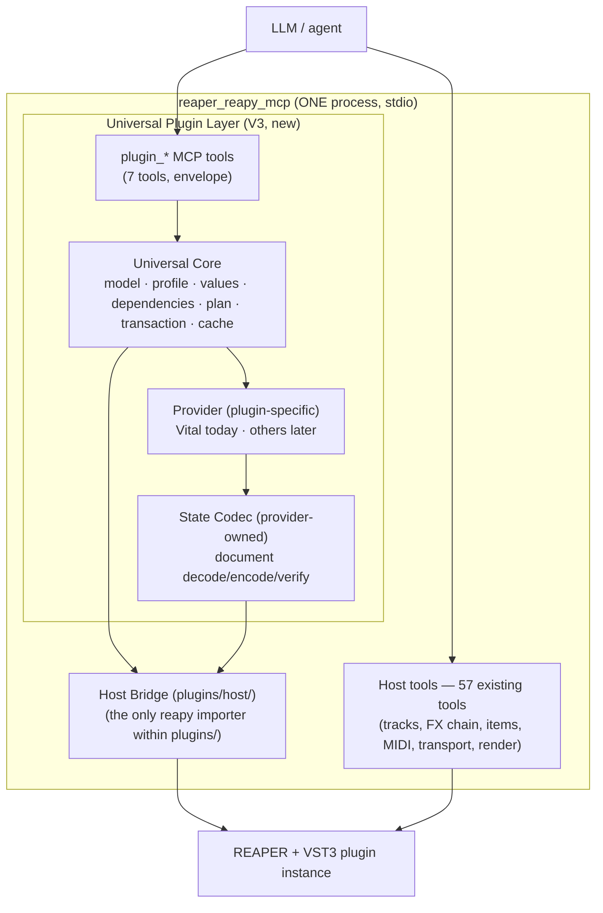
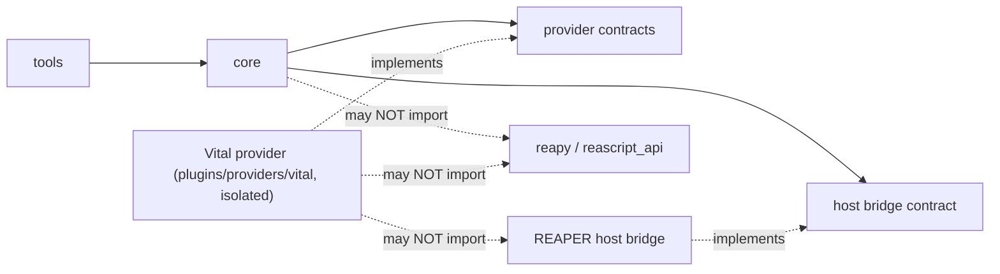
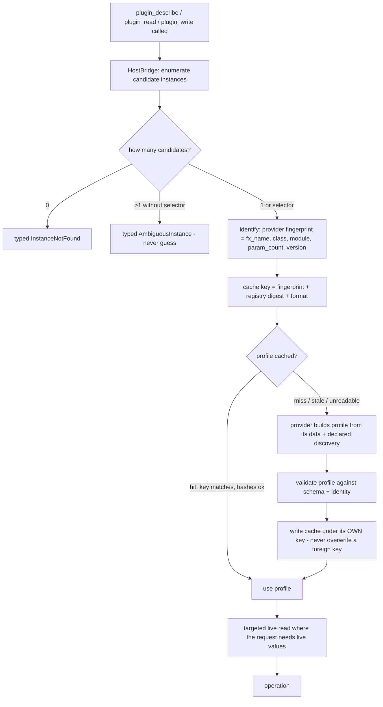

# 04 — Architecture

Status: **[D] proposed** design (rev. 2026-10-10, Phase C remediation → Phase D consolidation → Phase E approvals and handoff — see [18](18-remediation-register.md), [19](19-owner-decisions.md), [20](20-implementation-handoff.md)),
derived from the evidence in [01](01-existing-system-audit.md), [02](02-vital-poc-audit.md) and
[03](03-component-responsibility-matrix.md). Nothing here is implemented yet.

## 1. Layers and boundaries



| Boundary | Knows | Must NOT know |
|---|---|---|
| **MCP tools** (`plugins/tools.py`) | tool schemas, envelope, argument validation | anything about Vital, REAPER APIs, or transactions' internals |
| **Universal Core** | semantic controls, typed values, profiles, plans, transactions, cache contracts, universal errors | any Vital name/constant; any `reapy` import; any track/chunk detail |
| **Provider** (Vital) | control semantics, native bindings (ident), module topology, laws, rule content, codec, depth conversion | MCP transport; REAPER calls; other providers |
| **State Codec** (provider-owned) | document decode/encode, structural ops, per-field authority | host transport (chunks are handed to it as bytes/text) |
| **Host Bridge** (`plugins/host/`) | reapy/`reascript_api`, track/FX resolution primitives, param batch IO, chunk read/write, call timeouts | sonic concepts, module names, laws, route semantics |
| **Existing host tools** | unchanged | nothing new required |

The POC states the same rule for its own bridge — *"the dumbest component in the system: it moves
values and reports what it found"* — and the target repo's existing MCP violates it today only in the
sense that controllers mix policy with transport; V3's plugin path must not repeat that [A: POC
`bridge/README.md`; 01 §4].

## 2. Dependency direction (compile-time rules, test-enforced)



Enforced by boundary tests ([12 §2](12-testing-strategy.md)): no `reapy`/`reascript_api` import
outside `plugins/host/`; no `vital`/provider identifiers in `plugins/core`; providers receive host
access only through the `HostBridge` contract object handed to them.

## 3. Runtime flows

### 3.1 Resolve → describe (discovery vs runtime separation)



The normal runtime path is **profile lookup → targeted read → operation → verify**; full discovery
happens only on a cache miss or identity change. Rationale is measured: ~110 of 192 calls in the
audited POC run were re-derivations of static data [C, 02 §7].

### 3.2 Verified write (the safety core)

```mermaid
sequenceDiagram
    participant T as plugin_write (tool)
    participant C as Core (plan+transaction)
    participant P as Provider + Codec
    participant H as Host Bridge
    participant R as REAPER + plugin

    T->>C: request (instance, changes, dry_run=true by default)
    C->>H: fx_facts + resolve; target token issued (session-scoped)
    C->>P: resolve semantic names/values (declarations, not guesses)
    P-->>C: typed values or typed refusals (nothing read/written yet)
    C->>H: read live state: targeted slice, routes, parameter capture scope
    C->>C: build plan; dependency findings on the PROJECTED world
    C->>C: build StateSnapshot (all mutable channels) + StateRevision
    alt snapshot incomplete OR hard dependency OR invalid input
        C-->>T: refusal — write_calls_attempted: 0, typed problems
    else dry_run
        C-->>T: preview (would_write, write_order, per-item changes)
    else apply
        loop each ordered StateWriteUnit (provider-declared order)
            C->>C: revalidate token + expected StateRevision
            C->>H: state unit: splice ONLY the selected block span, write chunk
            H-->>C: WriteAttempt (returned value recorded, never trusted)
            C->>H: settle; re-read chunk; re-locate slice
            C->>P: codec.decode(slice) + verify (writer's own comparison space)
            alt unit verify fails
                C->>C: rollback: restore document → restore captured parameters → verify both
                C-->>T: outcome (FAILED_AND_RESTORED / PARTIALLY / NOT_RESTORED / ROLLBACK_FAILED)
            end
        end
        C->>H: parameter batch (one hop, ident-addressed)
        H-->>C: WriteAttempt + read-back
        C->>C: verify every parameter in the space written; advance StateRevision from own read-back
        C-->>T: committed=true + per-item read-back + outcome block
    end
```

Hard rules visible in this diagram (each traceable to POC evidence or a Phase-C audit finding):

1. **Preflight before any host write** — invalid requests are refused with `write_calls_attempted: 0`
   [A: `llm.submit`; counter semantics [05 §2.8](05-universal-core-contract.md)].
2. **Dependency findings judged on the projected world** — the live snapshot's stale flags are
   overlaid with planned values before rules run, or a correct patch is falsely refused [A: `plan.project`].
3. **Target-aware state path (AUD-001).** State reads, writes and verification address a
   `TargetedStateSlice` — the exact block span uniquely correlated to the validated target — never
   the first `<VST>` block of the chunk. The bridge splices only that span; untouched blocks remain
   byte-identical. Ambiguous correlation ⇒ refusal before any mutation.
4. **Snapshot-or-refuse (AUD-002).** Every mutable channel the operation can touch (document,
   routes, full captured parameter vector) is captured and verifiably restorable **before** the
   first write; an incomplete snapshot refuses the mutation.
5. **Revalidate target + revision per unit (AUD-003/AUD-010).** The write-target token and the
   expected `StateRevision` are checked before each unit; the revision advances from the
   transaction's own verified read-back; a stale token or conflicting revision refuses — never a
   silent re-target. (Revision comparison is best-effort conflict detection; the host offers no
   compare-and-swap — [11 §7](11-planning-transactions-and-verification.md).)
6. **Write order is provider-declared and engine-enforced**, never chosen per call. Vital's declared
   order is state-then-parameters (a document write resets parameters) [A][C].
7. **Success = verified read-back**, compared in the space that was written. `SetTrackStateChunk`'s
   return is recorded, never trusted [A].
8. **Rollback is verified per channel**, in the provider-declared restoration order (restore
   document → restore parameters → verify document → verify parameters for Vital); `FAILED_AND_…`
   verdicts distinguish fully-restored / partially-restored / not-restored / rollback-failed, and a
   failed rollback is reported loudly — never folded into "ok:false" [A: DEC-19 reshaped by AUD-002].

### 3.3 Read

`plugin_read` performs targeted, batched reads: semantic names → provider bindings → one batched
host read → typed values with units/display. **Never** a per-control host round-trip when one batch
can answer; never read a control value from the document when the profile declares the parameter
channel authoritative (the Vital instance of this rule is universalized as *declared authority per
field*, see [05 §5](05-universal-core-contract.md)).

## 4. Invariants (V1, non-negotiable)

| # | Invariant | Source |
|---|---|---|
| I-1 | Success means verified state, never an API return value or a swallowed exception | POC DEC-22; `transaction._verify` |
| I-2 | Typed errors; nothing on the plugin path may convert a failure into a plausible value | POC `errors.py`; target repo's contrary defect in [01 §4] |
| I-3 | Every write: snapshot-or-refuse → plan → transaction → verify → commit, with rollback verified **per captured channel** and a loud `ROLLBACK_FAILED` outcome | POC `transaction.py`; AUD-002 |
| I-4 | No host write occurs before the authorise/validate/snapshot gates pass (`write_calls_attempted: 0` on refusal) | POC `executor.authorise`, `submit`; AUD-002 |
| I-5 | Read/write authority per field is **declared by the profile** (parameter vs state), never guessed | POC §6.3 (instance); V3 generalization |
| I-6 | Full discovery is not repeated per request: profile lookup + targeted reads is the hot path | POC forensic accounting [C] |
| I-7 | Cache key = fingerprint + provider revision + provider artifact digest + source digest + format; a foreign or mismatched entry is never silently replaced (quarantine-then-write) | POC `capability_cache.py`; AUD-008/AUD-012 |
| I-8 | Capability Profile (static) ≠ Runtime State (live) ≠ Transactional Snapshot (ephemeral; must be complete or the write is refused) ≠ Persistent Restore Point (**deferred from V1**) | POC §8.5 / DEC-19; AUD-002/AUD-009 |
| I-9 | Identity is opaque outside the host+provider; no invented ids; ambiguous instance raises rather than guesses; stale fingerprint re-resolves once then raises. **Three concepts stay separate: profile fingerprint, write-target token, state revision** | POC DEC-08/DEC-11; AUD-003 |
| I-10 | Write order is explicit, provider-declared and enforced (not caller-configurable) | POC DEC-17 (instance) |
| I-11 | Universal Core contains no Vital identifier and no `reapy` import; **within `plugins/`**, `reapy` is imported only by `plugins/host/reaper.py` (the repo-wide claim is withdrawn — pre-existing host modules already import reapy) | POC DEC-03/DEC-04; AUD-013 |
| I-12 | A wedge times out and reports; an unreadable value is reported unreadable — never defaulted | POC bridge TBD#4/#5 |
| I-13 | Per-instance serialization keyed to the **validated target token** (not a slot number/string); held from final resolution through the complete verified outcome and recovery path | POC §4.3 lock [C]; AUD-010 |
| I-14 | Named gaps are diagnostics for **reads**; for writes, an incomplete capture is a refusal before the first write (Phase C reversal of DEC-19's role) | AUD-002 |
| I-15 | State targeting is slice-exact (AUD-001): reads, writes and verification address only the block uniquely correlated to the target; a mismatched or ambiguous correlation causes zero writes and untouched blocks stay byte-identical | AUD-001 |
| I-16 | Target token and expected revision are revalidated before each write unit and each parameter batch; stale/mismatch ⇒ refusal (or rollback mid-sequence) — never a silent re-target | AUD-003/AUD-010 |
| I-17 | No compare-and-swap exists on the host: revision checks are **best-effort conflict detection**, and the residual external-race window is documented, not denied (owner acceptance required before the guarantee freezes) | AUD-010 |
| I-18 | Server lifecycle: the process requires REAPER at startup (pre-existing eager `reapy.connect()`); post-startup connection loss yields typed `NotConnected` from the affected call. No promise about a process that never started | AUD-006 (Option A) |

## 5. Failure handling model

Failure classes (all typed, all distinguishable by the caller) — full table in
[05 §7](05-universal-core-contract.md) and [11 §4](11-planning-transactions-and-verification.md):

1. **Refused before any host access** — invalid input, unknown control, unmet dependency, bad unit.
   Result: `error` + `outcome.verdict=REFUSED_BEFORE_ANY_WRITE`, `outcome.host.write_calls_attempted == 0`.
2. **Refused before write after reads** — plan cannot be built against the live table (e.g. route
   table shape changed between read and plan), snapshot incomplete, target token stale, revision
   conflict. Result carries the state it resolved against; **zero write calls**.
3. **Write issued, not applied** — read-back mismatch (`WriteNotApplied`) with per-change
   classification; rollback attempted in the provider-declared order.
4. **Verification failure after apply** — same as 3 but detected at the verify stage.
5. **Rollback outcomes (per channel, Phase C):** `FAILED_AND_RESTORED` (every captured channel
   verified restored) / `FAILED_AND_PARTIALLY_RESTORED` / `FAILED_AND_NOT_RESTORED` /
   `ROLLBACK_FAILED` (rollback raised or unverified — the loud case). An *attempted* rollback is
   never reported as a *verified* one. `final_state` uses the audit vocabulary:
   `committed` / `unchanged_verified` / `partially_restored` / `unknown` ([11 §3](11-planning-transactions-and-verification.md)).
6. **Host transport failures** — `NotConnected`, `Wedged`, `Unreadable`, `HostContractUnavailable`;
   never retried in-process without a user-visible reason; a wedge mid-write reports
   `write_effects_unknown > 0` with `final_state: unknown` ([11 §4](11-planning-transactions-and-verification.md) F9).
7. **Cancellation (AUD-010)** — a cancelled operation transitions to a truthful final-state report
   (typically `unknown` unless the unit completed and verified); it is never assumed that stopping
   execution prevented mutations.

## 6. Frozen package layout in the target repository (Phase C, AUD-013)

One topology, referenced identically by every document, diagram, task and test:

```
src/reaper_reapy_mcp/plugins/
├── __init__.py            exports setup_plugin_tools
├── errors.py              typed plugin errors (extends the POC taxonomy + Phase-C additions)
├── model.py               PluginInstanceRef, CapabilityProfile, ControlCapability,
│                          ModuleDescriptor, RouteRef, ValueSpace, Finding, PlanItem,
│                          Outcome, and the §2.9 object set (05)
├── profile.py             profile schema version, validation, provenance digest helpers
├── provider.py            PluginProvider + StateCodec protocols
├── host/
│   ├── __init__.py
│   ├── contract.py        HostBridge protocol (no reapy)
│   └── reaper.py          REAPER HostBridge implementation — the ONLY reapy importer in plugins/
├── providers/             in-tree provider loader/registry (config-driven; empty in V1)
├── cache.py               capability cache (keying/refusals; quarantine + atomic writes)
├── resolve.py             instance resolution + target tokens (session-scoped)
├── values.py              typed value resolution + provider law application
├── dependencies.py        finding evaluation engine (rules come from provider)
├── plan.py                plan builder (projection against live state)
├── transaction.py         snapshot/apply/verify/commit/rollback engine (revision-aware)
├── tools.py               plugin_* tool registration (setup_plugin_tools)
└── README.md              the layer contract (adapted from POC bridge/README + §3 rules)
```

Import boundary (normative): **inside `plugins/`**, `reapy`/`reascript_api` may be imported only by
`plugins/host/reaper.py`; core/provider modules never import host internals; the boundary tests are
scoped to `plugins/` (the repository's pre-existing host modules already import reapy and are out of
scope — the Phase-A repo-wide claim was wrong and is withdrawn).

Provider placement (V1, Phase-D recommended — [19 Decision 2](19-owner-decisions.md)): the Vital provider is an
**in-repo, dependency-isolated package** at `src/reaper_reapy_mcp/plugins/providers/vital/`
implementing `PluginProvider`/`StateCodec`, with its codec **extracted from the verified host-free
function set** ([17 AV-13](17-planning-evidence-index.md)) and validated by the POC's byte-identity
fixtures. It imports **no** `reapy`/`ReaperController`/`_bh_session`/`_b4_lib` (AUD-005). The Vital
registry data is read from a configured directory (`REAPER_MCP_VITAL_REGISTRY_DIR`, default the POC
registry directory) — not vendored by default; the profile records the digest of the files actually
read, and offline tests use pinned fixtures so the suite needs no `C:\REAPER`. Enablement:
`REAPER_MCP_PLUGIN_PROVIDERS` lists provider ids; unset ⇒ zero providers enabled. Plugin tools are
registered **unconditionally**; a call with no applicable provider (or no server start) returns a
typed `UnsupportedProvider` result (AUD-013/AUD-014 Q-05).

## 7. What changes relative to the POC (summary)

| Aspect | POC | V3 |
|---|---|---|
| Server | separate `vital` FastMCP | tools added to the existing `Reaper Control` server |
| Startup lifecycle | lazy connect | **unchanged pre-existing eager `reapy.connect()`**; REAPER required at start; post-startup loss ⇒ typed `NotConnected` (AUD-006 Option A) |
| Provider boundary | implicit (adapter *is* Vital) | explicit `PluginProvider` contract; Vital is one implementation; legacy codec chain never imported (AUD-005) |
| Host boundary | `bridge/` with Vital codec inside `state.py` | `plugins/host/reaper.py` (transport + targeted slice) + provider codec (semantics) |
| State targeting | **first-VST-block defect** (AUD-001) | `TargetedStateSlice`: span-exact extract/splice; ambiguous correlation = refusal |
| Identity | fingerprint compare-on-use only | **three concepts**: profile fingerprint, session-scoped write-target token (revalidated per unit), state revision (AUD-003) |
| Transaction snapshot | document + routes (memory) | **complete captured-channel snapshot or refusal** (document + routes + parameter vector) (AUD-002) |
| Rollback | verified for document+routes; parameters named-gap | verified **per captured channel**; restore order provider-declared (document → parameters → verify both); `FAILED_AND_PARTIALLY_RESTORED` / `unknown` outcomes |
| Tool surface | 24 tools incl. escape hatches and CLI mirrors | 7 tools, batch-first; **mutators default to dry-run**; no raw escape hatch in V1 |
| Restore points | path-based `snapshot_state`/`restore_state` | **deferred from V1** (transactional snapshots only, memory) (AUD-009) |
| Cache key | identity + registry digest | + **provider implementation revision + provider artifact digest** (behaviour-affecting logic) (AUD-008) |
| Cache write safety | overwrite at same path, non-atomic | validate-identity → quarantine foreign/mismatched → atomic temp+replace (AUD-012) |
| Outcome reporting | envelope with `ok`/typed error | envelope schema 2: `error` **separate from** `outcome` (stage/verdict/final_state/rollback/host accounting) (AUD-007) |
| Discovery | Vital locator | generic resolve + provider identify + target tokens |
| Concurrency | per-instance lock | lock keyed to target token; revision checks per unit; residual-race limitation documented (AUD-010) |
| CLI | first-class second consumer | dropped from V1 (MCP-first; brief §17) |

## 8. Non-goals restated for the architecture

No sound-design knowledge in this layer; no module graph inference ("all plugins have filters" is
forbidden); no DSP/metrics/rendering; no new host-level tools; no second server; no speculative
provider ecosystem; no dependency DSL beyond provider data + finding evaluator. **Deferred from V1
by decision (AUD-009/AUD-014):** persistent restore-point subsystem, raw parameter escape hatch,
caller-controlled settle timings, lazy-startup redesign (AUD-006 Option B requires explicit owner
approval), VST2 support (fails closed), and unrelated maintenance of the existing 57 tools.
