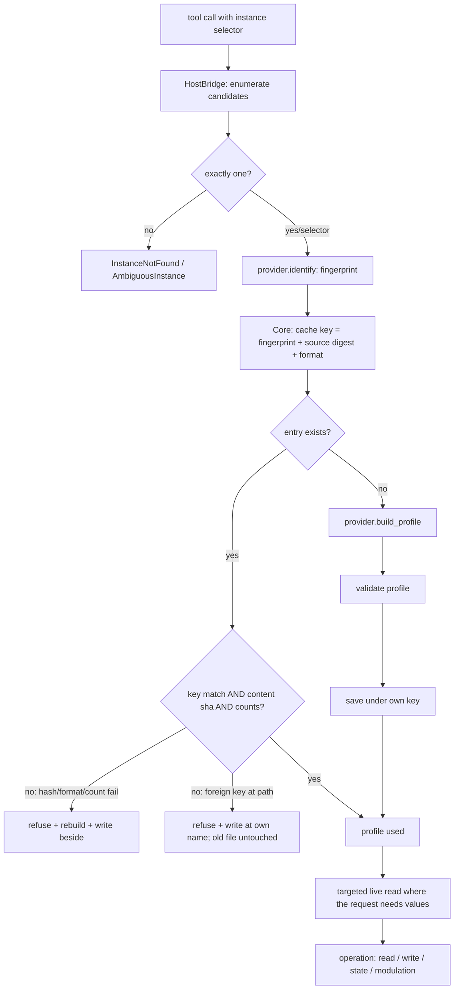

# 09 — Discovery and Cache

Status: **[D] proposed** (rev. 2026-10-11, Phase C remediation → Phase D consolidation — see [18](18-remediation-register.md) and [19](19-owner-decisions.md)),
ported from the POC's measured cache discipline [A: 02 §5, §7] **with two Phase-C corrections**: the
key covers every behaviour-affecting provider determinant (AUD-008), and the cache-write path is
specified to preserve foreign/mismatched files and to be crash-safe (AUD-012 — source verification
showed the POC's `save()` does neither: [17 AV-06/AV-07](17-planning-evidence-index.md)).

## 1. Lifecycle (what happens on each call)



**Runtime hot path:** profile lookup → (targeted live reads if needed) → operation. Discovery is
**not** repeated per request. The measured cost of not doing this: 192 calls in one audited run,
102 capability calls, 98 about a single control, ~110 answerable from static data [C: POC forensic
accounting recorded in `capability_cache.py`'s docstring].

## 2. Identity and fingerprint

- Identity = host location **hint** + provider fingerprint. The fingerprint is what makes the
  profile valid; the location is not ([05 §5]).
- Vital fingerprint [A]: `fx_name`, `vst_class` (chunk class hex), `module` (`vital.vst3`),
  `param_count`; optional `synth_version`. Required subset: `vst_class` + `param_count` (these
  discriminate a Vital build from another one; version absence is legitimate key material, not a
  refusal) [A: POC `REQUIRED_IDENTITY_FIELDS` precedent].
- Fingerprint is re-checked at use (compare-on-use): mismatch → re-resolve once → `StaleInstance`,
  never a silent retarget [A: `locate.validate`].
- GUIDs/pointers are **never** identity (POC measured a GUID as a raw process pointer) [A: DEC-11].

## 3. Cache key (normative — Phase C, AUD-008)

```
key = sha256( provider_id
              + canonical(fingerprint fields, sorted)
              + provider_revision        # declared implementation revision (behaviour-affecting logic)
              + provider_artifact_digest # sha256 over provider.artifact_paths()
              + source_digest            # digest over the provider data files the profile derives from
              + profile_schema_version + cache_format_key )
```

Every component is load-bearing:
- **fingerprint**: a different plugin build with the same data files is a different key.
- **provider_revision + artifact_digest (AUD-008)**: the effective profile depends on provider
  **logic** — dependency rules, law fitting, codec behaviour, write order, verification policy,
  declared limits — not only on registry JSON. A digest that omits provider logic "is not sufficient
  if the effective profile depends on code-defined limits" (audit). Any semantic change to a
  declared artifact requires bumping `implementation_revision` in the same change; a release that
  changes behaviour without a bump is a release bug. A missing revision/digest ⇒ no validated-profile
  cache entry (§6).
- **source_digest**: the provider's registry files are *generated*; regenerating them is normal.
  "A cache keyed on the plugin alone would serve yesterday's ranges after a regeneration —
  silently, because a stale range looks exactly like a fresh one." [A: POC docstring]
- **schema/format**: a structural change must rebuild, not mis-read [A: `CACHE_FORMAT_KEY`].

## 4. Storage policy (justified default)

| Aspect | V1 default | Rationale |
|---|---|---|
| Location | **user-local** cache dir, default `%LOCALAPPDATA%\reaper_reapy_mcp\cache\plugins\`, with an explicit `REAPER_MCP_PLUGIN_CACHE` env override (AUD-014 Q-07) | the POC stores under its own log root ("holds no knowledge… deletable at any moment"); the plugin cache must not live inside source-control trees unless deliberately configured |
| Format | one JSON file per key, `profile_<key12>.json` | content-addressable, inspectable, deletable |
| Identity validation before replacement (AUD-012) | a file at the expected path is read and its embedded key/identity are checked **before** any replacement; a mismatch/foreign/unparsable file is **quarantined by atomic rename** (bytes preserved), never overwritten | the POC's `save()` overwrites without validation; the V3 requirement is preserve-or-refuse, and the quarantine path is reported |
| Atomicity (AUD-012) | temp file + `os.replace`; interrupted writes leave at most an ignorable `*.tmp-*` file; readers never observe a partial target | crash-safe with no cross-process locking needed |
| Content hash | stored in the file (excluding volatile stamp fields); recomputed on load | truncation and tampering detectable |
| Count cross-check | `counts.controls` recomputed and compared on load | a lost tail must fail **two** independent checks [A] |
| Eviction | none automatic in V1; files are small and deletable; `plugin_describe` reports cache status | predictability over cleverness; the POC never auto-evicted |
| Git | the cache directory is runtime data; it must be git-ignored if placed in-tree (it is not, by default) | evidence discipline |

`cache_status()` (surfaced in `plugin_describe.meta`) reports: key, source of the profile
(`cache` | `built` | `rebuilt`), refusals with reasons, and file path.

## 5. The five refusals — V3 requirements, corrected (Phase C, AUD-012)

The Phase-A text claimed these were "ported verbatim" from the POC, including "the old file is left
byte-identical". Source verification shows the POC's `save()` overwrites whatever sits at the path
(no identity validation, no quarantine, no atomic write) — so cases 4 and 5 below are **new V3
requirements**, not inherited behaviour.

1. **No usable identity** → build in memory; **no cache read or write**; and per AUD-008 the
   instance's **writes, modulation mutations and restore are disabled** (diagnostic reads permitted,
   marked provisional).
2. **No file** → build; write via temp file + `os.replace` (atomic where the filesystem guarantees
   it); report `source: "built"`.
3. **Unreadable/unparsable file** → do not overwrite blindly: if a file exists, **quarantine by
   atomic rename** to `<path>.invalid-<utc>` (bytes preserved), then write fresh; report the reason
   and the quarantine path.
4. **Foreign key at the expected path** → refuse to replace in place: quarantine, write fresh at the
   expected path; the original bytes survive at the quarantine path and are reported.
5. **Content hash / source digest / provider revision / format mismatch** → REFUSE the file,
   quarantine, rebuild, report.

**Write mechanics (normative):** atomic temp-file + rename; a reader never observes a partial
target; an interrupted write leaves at most an ignorable `*.tmp-*` file; quarantine uses a rename
(never copy-and-delete) so the bytes cannot be lost mid-operation.

## 6. Errors and status

- Cache problems never fail a tool call that can proceed: they downgrade to `built` and add a
  `warning` row (`{"rule": "cache", "reason": ...}`).
- The one hard case: **identity cannot be established** (a required fingerprint field is missing,
  e.g. `param_count` unreadable) → profile is in-memory only; `plugin_describe` says so, and per
  AUD-008 the instance is **write-disabled**: `plugin_write`, `plugin_modulation` mutations and any
  restore refuse (`SnapshotUnavailable`/`VersionMismatch`-class refusal with the missing field named);
  reads are served **marked provisional**. "Diagnostic/provisional reads" never become a basis for a
  mutation. The same fail-closed rule applies when `provider_revision`/`provider_artifact_digest`
  cannot be determined: no validated-profile cache entry is written or served.

## 7. Invalidation

See [07 §5](07-capability-profile-schema.md#5-invalidation). Core-side rules:

| Event | Action |
|---|---|
| fingerprint mismatch at use | re-resolve; rebuild profile; old key never served |
| version ∉ `compatible_versions` | refuse writes (V1 policy — [07 §3.2](07-capability-profile-schema.md)) |
| provider data regenerated | new source digest ⇒ new key |
| **provider logic changed (dependency rules, codec, verification policy, limits)** | new `provider_revision`/artifact digest ⇒ new key (AUD-008) |
| schema bump | new format ⇒ all rebuild lazily |
| explicit user invalidation | delete the cache directory (documented; always safe) |

## 8. What discovery must NOT attempt (V1)

- No attempt to derive semantics (module topology, value laws) from generic host enumeration —
  arbitrary VSTs do not expose a universal semantic model [D; brief §10]. V1 providers are
  data-built (Vital) or minimal-probe (future).
- No network, no plugin database files beyond what a provider explicitly declares.
- No per-request full sweep: a write never re-sweeps all parameters; the POC calls this the
  per-control tax [C].

## 9. Required tests

- Key stability/change matrix (§3): same inputs ⇒ same key; **each** determinant changed ⇒ different
  key — fingerprint, source digest, provider_revision, artifact digest, schema/format (AUD-008).
- Five refusals: one test each, including **byte-compare** proof that a quarantined file's bytes are
  preserved and that the original path never contained different bytes after a quarantine+write.
- Truncation fixture fails content-hash **and** count checks → quarantine+rebuild.
- Corrupt JSON, wrong schema version, missing revision/digest, missing provenance → refuse + rebuild + warning.
- Interrupted-write simulation: kill between temp-write and replace → target absent or old; temp file
  ignored; no partial target ever read.
- No-identity path: no file written; **writes/mutations disabled**; provisional reads marked.
- Concurrency smoke: two writers, no partial file visible (atomic rename).
- Hot-path assertion: `plugin_describe` after a cache hit performs **zero** host param reads
  (mock bridge counts calls) — the tax must not return.
