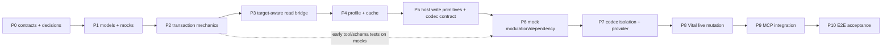

# 14 — Implementation Plan

Status: **PHASE D — AWAITING OWNER APPROVAL** (rev. 2026-10-11; Phase C remediation in
[18](18-remediation-register.md), Phase D consolidation in [19](19-owner-decisions.md)).
Executable only after the Phase-B audit findings are resolved (**done in docs, see
[18](18-remediation-register.md)**) and the four owner decisions in
[19 §6](19-owner-decisions.md) are recorded as approved. **Phase order corrected per audit AUD-011:** no live-write work may
precede the target-aware bridge, the complete recovery contract, the host write primitives and the
provider codec; every phase names its tests and exit conditions; no phase begins before the previous
phase's exit criteria are met.

Global rules for every phase:

- No change to the existing 57 tools or their behavior; no change to `project_controller.py` (staged
  user change) or any unrelated file ([01 §7]).
- No Vital identifiers inside the plugin core modules; **within `plugins/`**, `reapy` is imported only
  by `plugins/host/reaper.py` (L0 tests scoped to `plugins/` — AUD-013).
- No import of the legacy `_b4_lib`/`_bh_session` chain anywhere in `plugins/` or the provider (AUD-005).
- Every phase ends with: offline suite result (counts), new tests listed, evidence artifacts named,
  and a short design note appended to this document if a contract changed.
- A phase that modifies the staged `project_controller.py` content, reverts or rewrites unrelated
  tracked artifacts, or leaves an evidence file written by a live-requiring test in a failed state
  has failed **regardless of its test results** ([01 §7]).
- Every phase states its **failure conditions** — the observable outcomes that mean the phase did
  not succeed. A phase that cannot name them is not ready to start.

---

## P0 — Contracts and owner decisions

**Goal:** resolve the safety-critical contract questions and record the remaining approved choices,
then turn the [05](05-universal-core-contract.md)–[11](11-planning-transactions-and-verification.md)
contracts into importable, empty-bodied code artifacts so tests can be written against them.

**Prerequisites:** Phase D approval of this remediated documentation set; the audit disposition in
[18](18-remediation-register.md).

**Expected files:** `src/reaper_reapy_mcp/plugins/{__init__.py, errors.py, model.py, profile.py,
provider.py, host/{__init__.py, contract.py}, tools.py(skeleton)}`; unit-test stubs under
`tests/plugins/`.

**Contracts touched:** [05] domain objects + protocols (§2.9 object set); [07] profile schema
(incl. provider_revision/artifact digest); [06] envelope schema 2 + `TOOL_NAMES`/`SPEC`/`DISPATCH`
tables (dry-run defaults); [09] cache key composition.

**Owner decisions at this gate:** the four genuine approval decisions are collected, with
recommended answers, alternatives and consequences, in
[19-owner-decisions.md](19-owner-decisions.md) — (1) complete-capture-or-refuse recovery guarantee;
(2) in-repo isolated provider package + extracted host-free codec; (3) acceptance of the residual
cross-process race; (4) retention of the eager startup lifecycle. Everything else already carries a
`RECOMMENDED_DEFAULT`, a `RESOLVED_BY_SOURCE` answer or a `DEFERRED_FROM_V1` position
([15 §2](15-risks-and-open-questions.md)). **"Approved" is recorded only when the owner actually
approves** — never assumed, and never by editing a status on the owner's behalf. P0 begins when the
owner's answers are recorded in [19 §6](19-owner-decisions.md).

**Tests:** import smoke; protocol conformance stubs (xfail until implementations); L0 boundary test
scoped to `plugins/` (no `reapy` import; no provider identifiers in core); tool-name collision check
(spec 7 names disjoint from the 57); mutation-default audit (every mutator spec declares
`dry_run: true`).

**Acceptance criteria:** all modules import with zero side effects; boundary tests pass; the profile
schema file is committed as a JSON-Schema-like validator with the [07 §4] table encoded as tests;
all owner decisions recorded in [19 §6](19-owner-decisions.md) (no decision left
`OWNER_APPROVAL_REQUIRED` at implementation start).

**Risks:** over-modeling (mitigate: objects limited to [05 §2/§2.9] field tables; anything else is
rejected by review).

**Verification:** `pytest -q tests/plugins` offline; `python -c "import reaper_reapy_mcp.plugins"`
under the launch's Python.

**Failure conditions:** a contract question is answered by writing behavior instead of recording a
decision; a decision is marked approved without the owner; a module performs host work at import
time; a plugin tool name collides with one of the existing 57.

**Exit criteria:** contracts importable; boundary + schema tests green; all decisions recorded; no
behavior implemented.

---

## P1 — Universal models, identity objects and mock fixtures

**Goal:** implement the domain models and the objects everything else is proven against — target
tokens, state revisions, snapshots, outcome — plus the test doubles: `MockHostBridge` (multi-block
chunks, replaceable instance handle) and `MockProvider` + a second mock codec with a different
document shape ([12 §6]).

**Prerequisites:** P0.

**Expected files:** `plugins/model.py` (real bodies incl. §2.9 objects), `plugins/errors.py`,
`plugins/resolve.py` (token model, session-scoped); `tests/plugins/mock_host.py`,
`tests/plugins/mock_provider.py`, `tests/plugins/mock_codec_b.py`, fixture factories
(multi-block chunks, token/revision fixtures).

**Contracts touched:** [05 §2, §2.9, §5, §7]; [12 §6].

**Tests (L1):** model validation matrix; error serialization (`to_dict`) round-trip; **target-token
semantics** (issuance, revalidation pass/fail, never serialized); **revision advance** rules (B-43);
mock host call log semantics (order + counters); failure injection modes (`raise`, `wedge`,
`store-nothing`, `drop-after-return`); multi-block chunk fixtures with byte-comparison utilities.

**Acceptance criteria:** every field table row has a test; mocks can produce every F1–F12 situation
from [11 §4] on demand; both mock codecs pass the same document-shape-independent helpers.

**Risks:** mocks diverging from real host semantics — mitigated by the host-bridge conformance suite
([12 §4]) which the same tests will later run against the real bridge.

**Verification:** L1 suite green; token/revision fixtures demonstrated; mock call-log fixture
shows per-batch (not per-control) calls.

**Failure conditions:** a target token is serialized into any output or artifact; a mock cannot
produce one of the F1–F12 situations; a mock's behavior contradicts the host-bridge conformance
suite later (a mock that hides host semantics); a model field changes without the documentation
update the global rules require.

**Exit criteria:** models, tokens, revisions and mocks frozen; any later model change requires a doc
update (rule above).

---

## P2 — Universal transaction mechanics (mock-proven)

**Goal:** implement the pure mechanics against mocks: value resolution/laws, finding engine, plan
builder with projection, and the full transaction state machine — complete-capture-or-refuse
snapshot, ordered units, per-unit token/revision revalidation, verify-in-written-space, per-channel
verified rollback, outcome schema.

**Prerequisites:** P1.

**Expected files:** `plugins/values.py`, `plugins/dependencies.py`, `plugins/plan.py`,
`plugins/transaction.py`.

**Contracts touched:** [05 §2.8/§2.9/§4-§6]; [11] in full.

**Tests (L1/L2):** the [11 §8] matrix — preflight refusals (`write_calls_attempted == 0`); projection
fixture; **snapshot-or-refuse (B-32)**; document-before-parameters order (mock call log);
reversed-order refusal; dry-run default writes nothing; **all 8 verdicts + verdict↔final_state
mapping (B-45)**; per-channel rollback verification (B-33…B-37); document-reset restore-order
fixture (B-37); space-correctness regression; "API success, stores nothing" ⇒ `WriteNotApplied`;
multi-unit partial failure (B-23); **token/revision per-unit revalidation (B-41/B-42)**;
cancellation transitions (B-51/B-52); counter consistency (B-46); injected settle/retry timings.

**Acceptance criteria:** every verdict and every F1–F12 row has a test; no test uses a wall-clock
sleep; the transaction performs one batched parameter write and one state unit per structural unit
on the mock; registration/tool schemas of the 7 tools are testable against mocks **now** (early
registration tests, AUD-011).

**Risks:** re-deriving semantics instead of porting POC behavior — mitigate by recording the POC
symbol implementing each behavior in the test docstring (traceability per [17]).

**Verification:** full offline suite green; coverage of transaction branches reported.

**Failure conditions:** a write proceeds with an incomplete capture set; a snapshot omits a mutable
channel; rollback is reported verified without comparing **every** captured channel; one verdict maps
to two different `final_state` values; a test requires a wall-clock sleep; any test passes only
because the mock smooths over ordering (document→parameters).

**Exit criteria:** mechanics complete and mock-proven; no host code exists yet.

---

## P3 — Target-aware, read-only REAPER bridge + L3 read validation

**Goal:** implement `plugins/host/reaper.py` **read paths only**: lazy connection, one timeout/wedge
chokepoint, `fx_facts`, batch parameter reads, `read_state_chunk` + **`locate_state_slice`** — the
`TargetedStateSlice` mechanism with uniqueness enforcement (AUD-001). No write verb exists at the end
of this phase.

**Prerequisites:** P2 (conformance suite exists to run against it).

**Expected files:** `plugins/host/reaper.py`, `plugins/resolve.py` (instance resolution/session,
target tokens); host-bridge conformance read-suite; **the `TrackFX_GetFXGUID` measurement probe**
(session behaviour on slot re-population — [02 §19.8](02-vital-poc-audit.md)).

**Contracts touched:** [08 §4]; [05 §2.9](05-universal-core-contract.md) (`FxHostFacts`,
`TargetedStateSlice`).

**Tests (L2 + L3):** conformance read-suite on the real bridge with a live REAPER; **multi-block
slice location on mock chunks (B-26…B-31)** — including the preceding-foreign-VST and two-Vital
fixtures — with byte-equality of non-selected blocks and `TargetSliceAmbiguous` on mismatch;
`plugin_instances`/`plugin_describe` semantics offline via mocks; live: enumerate/resolve the test
instance, read params in a batch, read the selected slice; counters prove one call per batch;
wedge/timeout behaviour; **the FX-GUID measurement** recorded as evidence (feeds the identical-build
replacement question, Q-02 scope).

**Acceptance criteria:** live read of the designated test instance succeeds and matches recorded
identity (fingerprint); **no write path exists in the module (grep-asserted)**; slice location is
unique-or-refusal on every fixture; the FX-GUID behaviour is measured and its limitation documented.

**Risks:** reapy version drift (repo pins `>=0.9.0`); mitigations: mirror the POC's probed-shape
approach only where needed; record host versions in evidence. **Identical-build replacement may be
indistinguishable** — the measurement decides; fail closed where it is (AUD-003).

**Verification:** L3 evidence JSON (identity, param_count, batch timing, slice span, FX-GUID
behaviour) recorded per [12 §9].

**Failure conditions:** a write verb appears in `plugins/host/reaper.py` (grep-asserted); slice
location is not unique-or-refusal on any fixture (AUD-001 regression); a block is chosen by position
rather than by unique match; the FX-GUID behaviour is asserted instead of measured; a live read is
reported without a recorded evidence artifact; the selected span is not byte-identical outside the
slice.

**Exit criteria:** read path proven live; slice targeting proven on fixtures + live read; bridge
conformance read-suite green.

---

## P4 — Capability Profile and cache

**Goal:** profile building + cache with the **corrected key (fingerprint + provider_revision +
provider_artifact_digest + source_digest + schema/format)** and the corrected write discipline
(validate-identity → quarantine → atomic temp+replace), plus the fail-closed identity rules.

**Prerequisites:** P3 (identity available live), P1 (validation).

**Expected files:** `plugins/cache.py`; profile builder wiring in `resolve.py`; cache tests +
fixtures (corrupt/truncated/foreign/mismatched-file; interrupted write).

**Contracts touched:** [07] in full; [09].

**Tests (L1/L2/L3):** [09 §9] matrix — key stability; **B-47 key change matrix** (dependency rules,
codec revision, verification policy, provider version, registry data); **B-55 foreign-file
quarantine (byte-compare)**; **B-56 interrupted write**; truncation fails two checks; no-identity ⇒
no file **and writes/mutations disabled** (AUD-008 fail-closed); hot-path assertion (cache hit ⇒
zero host param reads).

**Acceptance criteria:** with the mock provider, describe works fully offline; with the live host,
profile key derived from live fingerprint + declared provider revision/artifacts; cache directory
configurable (user-local default, AUD-014 Q-07); `meta.cache` reports source; no foreign bytes lost.

**Risks:** cache path inside a git tree — default is outside source dirs; test asserts a warning
otherwise.

**Verification:** cache round-trip evidence; quarantine/refusal logs; key-matrix table archived.

**Failure conditions:** a cache hit serves a profile whose identity does not match the live
instance; a foreign or unknown file is overwritten or deleted instead of quarantined; a profile is
written without identity; the cache key omits any of its five components; the default cache
directory lands inside a source tree.

**Exit criteria:** describe/find served from cache with no host reads on hit; refusal + quarantine +
atomicity tests green; fail-closed identity proven.

---

## P5 — Host write primitives and the State Codec contract

**Goal:** implement the **write-side transport** — `write_params` (ident batch) and
`write_state_slice` (splice ONLY the selected span into the chunk; `SetTrackStateChunk`; settle;
re-read; no semantic callbacks in the bridge, AUD-004) — and the **StateCodec contract**:
`plan_state_writes` returning ordered `StateWriteUnit`s, `encode_slice`, `verify`, snapshot/restore
parts. Unit execution, per-unit token/revision revalidation, snapshot assembly from all channels and
the per-channel rollback path are wired into the P2 engine.

**Prerequisites:** P3 (read bridge + slice location), P2 (engine).

**Expected files:** `plugins/host/reaper.py` (write paths), `plugins/provider.py` (codec protocol
final), `plugins/transaction.py` (unit execution + snapshot assembly extensions); two-mock-codec
conformance suite; captured-chunk splice fixtures (offline).

**Contracts touched:** [05 §2.9/§3](05-universal-core-contract.md); [08 §3-§4](08-provider-and-host-interfaces.md);
[10 §1](10-state-modulation-dependencies.md); [11 §2.3-§2.4, §2.7](11-planning-transactions-and-verification.md).

**Tests (L1/L2):** codec conformance on **two mock codecs with different document shapes/batching**
(AUD-004); ordered units; sequential revisions; **rebase behaviour** (live slice re-read between
units); expected-revision conflicts (B-42); rollback through the codec; verification reports;
**target preservation** (splice fixture: every byte outside the selected span unchanged);
write-attempt accounting (B-46); the full document-reset restore-order fixture on mocks (B-37).
**No live mutation is performed in this phase** — splice/transport logic is proven against captured
chunk strings and the mock host; the live-write gate stays at P8.

**Acceptance criteria:** two codecs pass one conformance suite; splice byte-fidelity proven on
captured multi-block chunks; snapshot/restore contract complete and mock-verified; the bridge module
contains no provider predicate/verify callback (AUD-004).

**Risks:** codec contract overfitting Vital — mitigated by mock codec B's different shape and
two-unit batching; transport overfitting — the captured-chunk fixtures come from real recorded chunks.

**Verification:** conformance reports for both codecs; splice byte-comparison evidence.

**Failure conditions:** any live mutation occurs in this phase; a splice changes bytes outside the
selected span; the bridge contains a provider predicate or verification callback (AUD-004); the
codec conformance suite is tailored so only one codec can pass it; a write primitive remains
executable after a failed token/revision revalidation.

**Exit criteria:** codec + transport contract frozen and mock-proven; ready for the provider port.

---

## P6 — Mock-based modulation and dependency validation

**Goal:** `plugin_modulation` ops + the provider dependency hook, wired through the P5 codec and P2
engine — **entirely against mocks** (no live writes).

**Prerequisites:** P5.

**Expected files:** modulation tool body; depth conversion hook wiring; finding surfacing in
`plugin_write`/dry-run.

**Contracts touched:** [10 §2-§3]; [06 §9](06-mcp-tool-contracts.md).

**Tests (L1/L2):** deterministic ambiguity (first match + remaining list) **for reads**; **ambiguous
mutation selector refused (B-48)**; slot resolved in plan reported; vocabulary policy + `force` echo;
depth refusal (mock provider declares a fit refusal); hard dependency ⇒ refusal with
`write_calls_attempted == 0`; projected-world fixture re-run at this layer; multi-unit sequence
(N routes ⇒ N ordered verified units on the mock); **mutation-default audit re-run (B-49)**.

**Acceptance criteria:** all [10 §4] tests green on mocks; the mock provider's two-route model
exercises ordered-unit sequencing end-to-end.

**Risks:** none new; scope creep (a dependency DSL) explicitly rejected — rule content stays data.

**Verification:** dry-run output shows dependency findings and route plan with resolved slots.

**Failure conditions:** a mutation is accepted while its dependency findings are unresolved; an
ambiguous mutating selector is executed instead of refused; a depth conversion is applied without the
provider's declared fit check; the N-routes ⇒ N-ordered-units sequencing is not exercised by the
mock provider; a live write is attempted in this phase.

**Exit criteria:** modulation + dependencies complete against mocks; ready for the Vital port.

---

## P7 — Vital provider and codec isolation

**Goal:** build the Vital provider as an **in-repo, dependency-isolated package** at
`src/reaper_reapy_mcp/plugins/providers/vital/` implementing the V3 provider/codec contracts, porting
the **verified host-free codec function set** ([17 AV-13](17-planning-evidence-index.md)) and
validating it against the POC's byte-identity fixtures ([19 Decision 2](19-owner-decisions.md);
fallback: clean re-implementation against the same fixtures). **The legacy `_b4_lib`/`_bh_session`
chain is never imported** (AUD-005).

**Prerequisites:** P6; owner approval of Decision 2 (placement + extraction approach); frozen
provider contract.

**Expected files (in-repo):** `plugins/providers/vital/{__init__.py, provider.py, profile_build.py,
codec.py, dependencies_rules.py, depth.py}`; **recursive import-boundary test**; regression tests
reading recorded POC artifacts; the byte-identity fixture set for the codec; the
`REAPER_MCP_VITAL_REGISTRY_DIR` configuration note (README + [13 §4](13-existing-mcp-integration.md)).

**Contracts touched:** [08 §6-§7](08-provider-and-host-interfaces.md) mapping table.

**Tests (L5):** V-1 ident addressing; V-2 write order; V-3 one-route-per-write; V-4 depth
acceptance/refusals match recorded fit; V-5 dependency refusals; V-6 tolerances; V-7 full capture
scope + restore order (V3 contract); V-8 cache refusal/quarantine behaviour (V3 contract);
V-9 line_mapping refusal/warning; V-10 version gate with hard refusal; **V-11 slice-exact targeting
on multi-block fixtures**; **V-12 import cleanliness: a clean process importing the provider pulls in
no `reapy`/`ReaperController`/`_bh_session`/`_b4_lib` and does not change the working directory**;
plus L3 live read of the Vital instance through the provider. **No live writes in this phase.**

**Acceptance criteria:** V-1…V-12 green against recorded artifacts; live read matches POC-observed
identity fields; the recursive import test passes; **the host-touching functions (`_get_chunk`,
`_set_chunk`, `_default_ctrl`) are not ported**; no legacy module is imported anywhere in the
package; registry data is read through the configured directory and its digest appears in the
profile provenance.

**Risks:** the legacy-codec coupling is the reason this phase exists — if isolation fails, the
provider cannot be accepted ([15 R-03](15-risks-and-open-questions.md)); version 1.5.5-only support —
declared in profile limits, enforced by the version gate; a ported function still reading a module
global — mitigated by the fallback in [19 Decision 2](19-owner-decisions.md).

**Verification:** regression report; clean-process import evidence (module list + cwd); live read
evidence.

**Failure conditions:** the clean-process import pulls in `reapy`/`ReaperController`/`_bh_session`/
`_b4_lib` or changes the working directory; a host-touching function is ported; legacy code is
imported rather than extracted or re-implemented against fixtures; a version outside the measured set
is accepted for writes; the byte-identity fixtures are not re-run against the ported codec.

**Exit criteria:** provider behaves as the POC proved; isolation proven; unsupported cases refuse
with reasons.

---

## P8 — Vital live mutation validation (L4)

**Goal:** **the first live writes** — permitted only now that the target-aware bridge (P3), the
complete recovery contract (P2/P5), the provider codec (P7) and the identity model (P1/P3) exist and
are verified. Executed with the full-channel self-restoring harness.

**Prerequisites:** P3–P7; owner-approved live-write window; designated test project prepared;
P0 decisions recorded.

**Expected files:** `tests/plugins/live/` harness; evidence writer (per-run naming + content hash).

**Contracts touched:** [11](11-planning-transactions-and-verification.md) verification; [12 §7](12-testing-strategy.md).

**Tests (L4):** **full-channel capture → write → verify → restore → verify restore** on: one
parameter; one enum; one state path; two routes (sequential units); a dependency-refused request
(zero write calls); an induced failure → per-channel verified rollback; **a multi-block track case
proving untouched blocks byte-identical**; a cancellation case (B-51) reporting truthfully; evidence
JSON per run. **Every case's restore compares every captured channel — document, routes AND
parameters — before the word "restored" may appear (AUD-015).**

**Acceptance criteria:** every live case's response contains per-item read-back and a per-channel
rollback status; the harness refuses to run if preconditions (identity, responsiveness,
test-instance match) fail; before/after whole-range digest recorded; **no case claims restoration of
any channel it did not compare**.

**Risks:** live mutation — bounded to the test project; abort path documented (restore from the
session capture); plugin/session wedges (the harness's refusal path is itself exercised).

**Verification:** recorded L4 evidence with timestamps; whole-range digest check; per-channel
restore proofs.

**Failure conditions:** a live case runs without a complete capture; an "API success" is reported as
a write effect without a read-back proof in the written space; a case claims restoration of a channel
it did not compare (AUD-015); the harness proceeds when a precondition fails; untouched blocks are
not byte-compared; the test project is left in a state other than its captured pre-run state at the
end of the phase.

**Exit criteria:** live write path proven with per-channel verified restore; evidence attached.

---

## P9 — Existing MCP integration

**Goal:** register the 7 tools on the live server through the actual server boundary; prove
coexistence and explicit error propagation ([13 §3, §7]).

**Prerequisites:** P8 (or P2 for a dry integration rehearsal with mocks — registration/schema tests
run against mocks **early**, production integration lands here); P0 tool tables.

**Expected files:** `plugins/tools.py` final; `create_server()` one-line addition; tool docstrings;
repo README section.

**Contracts touched:** [06] in full; [13](13-existing-mcp-integration.md).

**Tests:** in-process FastMCP client test calling each tool (mock provider) incl. required-arg
refusal envelope; tool count = 64; existing 57 unchanged (names + one smoke call each via client);
inspector smoke (`test_mcp.bat` path exists [A]); docstring presence (the LLM sees args/purpose);
**unconditional registration**: with zero providers configured, every plugin tool answers a typed
`UnsupportedProvider` result ([06 §10](06-mcp-tool-contracts.md), AUD-013); **mutation-default audit
via the registered specs (B-49)**; startup lifecycle documented per AUD-006 Option A (the process
requires REAPER; post-startup loss ⇒ typed `NotConnected`).

**Acceptance criteria:** all 64 tools listed; plugin tools answer typed refusals when no provider is
configured; removing the registration line restores the prior server exactly; existing host tools
untouched.

**Risks:** client startup requires REAPER (pre-existing eager connect) — documented, not "fixed";
tests use the client with mocks where possible.

**Verification:** inspector output archived; tool-list evidence; UnsupportedProvider evidence.

**Failure conditions:** an existing tool's name, schema or behavior changes; a plugin tool is absent
from the list because no provider is configured (it must appear and answer a typed
`UnsupportedProvider`); removing the registration line does not restore the prior server exactly;
the startup-lifecycle consequence is undocumented.

**Exit criteria:** one server, 64 tools, no regressions.

---

## P10 — End-to-end acceptance, hardening, documentation

**Goal:** the acceptance scenario of [00 §6] end-to-end, plus hardening and repo documentation.

**Prerequisites:** P9.

**Expected files:** validation report (evidence-linked); final tool docs; risk-register updates.

**Tests (L3/L4):** the acceptance scenario: `plugin_instances` → `plugin_describe` → `plugin_find`
→ `plugin_read` → dry-run `plugin_write` (**the default**) → committed `plugin_write`
(`dry_run:false`; controls + one route) → `plugin_state(inspect)` → `plugin_modulation(list)` →
**full-channel restore of the test project with every captured channel compared**. Each step records
evidence; the final restore's per-channel verification is part of the report.

**Acceptance criteria:** [00 §6] items 1–7 each demonstrated with evidence; no unexplained failure;
all declared limits surfaced in outputs; the run's restore verified per channel (never "restored"
without comparison — AUD-015); untouched blocks byte-identical on the write step (AUD-001).

**Risks:** environment flakiness (audio/render not involved in V1 acceptance — deliberately);
plugin/session wedges (harness abort path exercised in P8).

**Verification:** archived evidence + a written validation report citing run artifacts.

**Failure conditions:** any acceptance item ([00 §6] items 1–7) lacks an evidence artifact; a limit
surfaces during acceptance that the profile did not declare; a mutation outcome is left ambiguous at
the end of a run when the harness could have resolved it; the test project is left unrestored; the
report claims a capability its evidence does not show.

**Exit criteria:** acceptance criteria met; documentation updated; owner sign-off recorded; the
phase-E cycle (subsystem → tests → boundary → review → next) closed.

---

## Dependency graph (corrected per AUD-011)

**Mandatory gates (no phase may rely on functionality that does not exist yet):**

1. **No live write** before target-aware state addressing (P3 `locate_state_slice`, unique-or-refuse)
   and the identity model (P1/P3 target tokens and revisions) are implemented.
2. **No live write** before the complete-capture-or-refuse snapshot and recovery contract is
   implemented and mock-proven (P2 ordered units, per-channel verified rollback). A weaker recovery
   implementation never reaches a host.
3. **No Vital live mutation** before codec isolation and provider conformance pass (P7 V-1…V-12,
   including the clean-process import test). Live writes are P8 only.
4. **No final integration acceptance** while any mutation outcome remains ambiguous: a run ending in
   `unknown`/`partially_restored` must be resolved and explained in the P10 report, never averaged
   away.
5. **No phase depends on a later phase:** each phase's tests run against mocks or host paths that
   already exist — registration/schema tests run against mocks from P2 onward even though production
   registration is P9, and P5 implements write *primitives* while performing **no live mutation**.
6. **No provider ported or copied before P7**, and then only the verified host-free function set
   ([17 AV-13](17-planning-evidence-index.md)); the legacy module chain is never imported (AUD-005).

A phase that needs a live write to prove itself is mis-planned and must be split.

## Cross-phase risks register pointer

All phase risks are summarized in [15 §1](15-risks-and-open-questions.md) with owners and
triggers; a phase may not exit with an **open high-severity** risk assigned to it.
