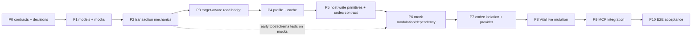

# 14 — Implementation Plan (P0-P10)

Status: **APPROVED ROADMAP — NOT STARTED.** Owner decisions 1-4 are `OWNER_APPROVED` (2026-10-10,
[19-owner-decisions.md](19-owner-decisions.md)); this plan is the roadmap the future implementation
session executes under the handoff in [20-implementation-handoff.md](20-implementation-handoff.md).
None of P0-P10 has begun; every test listed here is **specified but not run** and no phase may be
treated as proven because it is documented. **Phase order corrected per audit AUD-011:** no
live-write work may precede the target-aware bridge, the complete recovery contract, the host write
primitives and the provider codec; every phase names its tests, failure conditions and exit
conditions; no phase begins before the previous phase's exit criteria are met.

## How to read a phase

Every phase below is organized as:

| Label | Section in the phase | Label | Section in the phase |
|---|---|---|---|
| **A** | Goal (the problem it solves) | **G** | Tests (existing list) + Critical tests (initial → action → expected → invariant) |
| **B** | Prerequisites | **H** | Acceptance criteria |
| **C** | Scope — in / out | **I** | Failure conditions |
| **D** | Expected files | **J** | Exit criteria |
| **E** | Contracts touched | **K** | Documentation updates |
| **F** | Work items (numbered, in order) | | |

Expected files are **implementation targets for the future session**, not files to create now, and
they use the approved topology ([04 §6](04-architecture.md), [08 §8](08-provider-and-host-interfaces.md)):
`src/reaper_reapy_mcp/plugins/` with core modules flat plus `host/` and `providers/vital/`.

Global rules for every phase:

- No change to the existing 57 tools or their behavior; no change to `project_controller.py` (staged
  user change) or any unrelated file ([01 §7]).
- No Vital identifiers inside the plugin core modules; **within `plugins/`**, `reapy` is imported only
  by `plugins/host/reaper.py` (L0 tests scoped to `plugins/` — AUD-013).
- No import of the legacy `_b4_lib`/`_bh_session` chain anywhere in `plugins/` or the provider (AUD-005).
- Owner decisions 1-4 are binding; a phase that finds it needs to contradict one **stops and asks the
  owner** — it does not silently re-plan around an approved decision.
- Every phase ends with: offline suite result (counts), new tests listed, evidence artifacts named,
  and a short design note appended to this document if a contract changed.
- A phase that modifies the staged `project_controller.py` content, reverts or rewrites unrelated
  tracked artifacts, or leaves an evidence file written by a live-requiring test in a failed state
  has failed **regardless of its test results** ([01 §7]).
- Every phase states its **failure conditions** — the observable outcomes that mean the phase did
  not succeed. A phase that cannot name them is not ready to start.
- Nothing is `VERIFIED` because it is documented; a behavior becomes a claim only when its test has
  been written **and** run successfully, in the phase that owns it.

---

## P0 — Contracts and owner decisions

**Goal:** resolve the safety-critical contract questions and record the remaining approved choices,
then turn the [05](05-universal-core-contract.md)–[11](11-planning-transactions-and-verification.md)
contracts into importable, empty-bodied code artifacts so tests can be written against them.

**Prerequisites:** the owner's approval record in [19 §6](19-owner-decisions.md) (`OWNER_APPROVED`,
2026-10-10); the audit disposition in [18](18-remediation-register.md); the handoff package
([20](20-implementation-handoff.md)). No implementation work from P1 onward may start before this
phase's exit criteria are met.

**Expected files:** `src/reaper_reapy_mcp/plugins/{__init__.py, errors.py, model.py, profile.py,
provider.py, host/{__init__.py, contract.py}, tools.py(skeleton)}`; unit-test stubs under
`tests/plugins/`.

**Contracts touched:** [05] domain objects + protocols (§2.9 object set); [07] profile schema
(incl. provider_revision/artifact digest); [06] envelope schema 2 + `TOOL_NAMES`/`SPEC`/`DISPATCH`
tables (dry-run defaults); [09] cache key composition.

**Owner decisions at this gate:** the four genuine approval decisions are collected, with
recommended answers, alternatives and consequences, in
[19-owner-decisions.md](19-owner-decisions.md) — (1) complete-capture-or-refuse recovery guarantee;
(2) in-repo isolated provider package + extracted host-free codec; (3) acceptance of the residual
cross-process race; (4) retention of the eager startup lifecycle. Everything else already carries a
`RECOMMENDED_DEFAULT`, a `RESOLVED_BY_SOURCE` answer or a `DEFERRED_FROM_V1` position
([15 §2](15-risks-and-open-questions.md)). **"Approved" is recorded only when the owner actually
approves** — never assumed, and never by editing a status on the owner's behalf. P0 begins when the
owner's answers are recorded in [19 §6](19-owner-decisions.md).

**Tests:** import smoke; protocol conformance stubs (xfail until implementations); L0 boundary test
scoped to `plugins/` (no `reapy` import; no provider identifiers in core); tool-name collision check
(spec 7 names disjoint from the 57); mutation-default audit (every mutator spec declares
`dry_run: true`).

**Scope — in (C).** The `plugins/` package skeleton with importable, side-effect-free modules; the
normative error taxonomy; the envelope/tool tables; the profile schema validator; unit-test stubs;
the decision record (already approved, transcribed into code-adjacent docs where needed).

**Scope — out (C).** Any host access, any `reapy` import outside `plugins/host/reaper.py`, any
behavioral implementation (models stay declarative, `tools.py` stays a skeleton), provider code,
registration into `create_server()`, and any change to the existing 57 tools or to `pyproject.toml`
dependencies.

**Work items (F).**
1. Create the package tree (`plugins/__init__.py`, `errors.py`, `model.py`, `profile.py`,
   `provider.py`, `host/{__init__.py,contract.py}`, `tools.py` skeleton) with empty/decorator-only
   bodies and `from __future__ import annotations` for 3.10 compatibility.
2. Transcribe [05 §7] into `errors.py` as the closed exception list, each with a stable `code`
   string and a `to_dict()` returning `{code, message, detail}`.
3. Transcribe [05 §2, §2.9] object field tables into `model.py`/`profile.py` as dataclasses or
   typed dicts **without** behavior, keeping names identical to the documents.
4. Declare the `PluginProvider`/`StateCodec`/`HostBridge` protocols in `provider.py` /
   `host/contract.py` exactly as [08 §2-§4](08-provider-and-host-interfaces.md), including the
   `plan_state_writes` unit model and the absence of any provider callback in the bridge.
5. Encode the [07 §4] validation table as a validator plus one test row per rule.
6. Create `tools.py` as `TOOL_NAMES`/`SPEC`/`DISPATCH` tables for the 7 tools with `dry_run: true`
   defaults and synthesized docstrings — no tool bodies ([06](06-mcp-tool-contracts.md)).
7. Write the L0 boundary test scoped to `plugins/` (no `reapy` import outside `host/reaper.py`, no
   provider identifiers in core) with an explicit non-empty path list so it cannot pass vacuously.
8. Write the import-smoke and tool-name-collision tests; add the xfail protocol-conformance stubs.
9. Append the P0 design note recording any naming/typing decision that deviates from the documents.

**Critical tests — initial state → action → expected → invariant (G).**

| # | Initial state | Action | Expected result | Safety invariant |
|---|---|---|---|---|
| P0-1 | fresh checkout, REAPER closed | `python -c "import reaper_reapy_mcp.plugins"` | imports successfully, no host call, no filesystem read of the registry/cache | import is side-effect free — a server with zero providers touches nothing |
| P0-2 | plugin core modules present | run the L0 boundary test with a probe file that imports `reapy` in core | test fails | a boundary test that cannot fail on a violation is not a boundary test |
| P0-3 | 57 existing tools registered | compare the 7 spec names against the existing names | empty intersection | tool names are disjoint by construction, not by inspection |
| P0-4 | every mutator spec in the table | read the declared defaults | all mutators declare `dry_run: true` | no mutating call applies without an explicit opt-in ([19 Decision 1](19-owner-decisions.md) discipline) |

**Documentation updates (K).** Record any deviation from [05]/[06]/[07]/[08] naming in the P0 design
note; if a contract must actually change, amend the document first ([00 §7]) — the implementation does
not lead the specification.

**Acceptance criteria:** all modules import with zero side effects; boundary tests pass; the profile
schema file is committed as a JSON-Schema-like validator with the [07 §4] table encoded as tests;
all owner decisions recorded in [19 §6](19-owner-decisions.md) (no decision left
`OWNER_APPROVAL_REQUIRED` at implementation start).

**Risks:** over-modeling (mitigate: objects limited to [05 §2/§2.9] field tables; anything else is
rejected by review).

**Verification:** `pytest -q tests/plugins` offline; `python -c "import reaper_reapy_mcp.plugins"`
under the launch's Python.

**Failure conditions:** a contract question is answered by writing behavior instead of recording a
decision; a decision is marked approved without the owner; a module performs host work at import
time; a plugin tool name collides with one of the existing 57.

**Exit criteria:** contracts importable; boundary + schema tests green; all decisions recorded; no
behavior implemented.

---

## P1 — Universal models, identity objects and mock fixtures

**Goal:** implement the domain models and the objects everything else is proven against — target
tokens, state revisions, snapshots, outcome — plus the test doubles: `MockHostBridge` (multi-block
chunks, replaceable instance handle) and `MockProvider` + a second mock codec with a different
document shape ([12 §6]).

**Prerequisites:** P0.

**Expected files:** `plugins/model.py` (real bodies incl. §2.9 objects), `plugins/errors.py`,
`plugins/resolve.py` (token model, session-scoped); `tests/plugins/mock_host.py`,
`tests/plugins/mock_provider.py`, `tests/plugins/mock_codec_b.py`, fixture factories
(multi-block chunks, token/revision fixtures).

**Scope — in (C).** The domain objects of [05 §2/§2.9] with real bodies and validation; the identity
objects (profile fingerprint, session-scoped target token, mutable state revision); the test doubles
and fixture factories everything else is proven against.

**Scope — out (C).** Host access, transactions, planning, cache, provider code, tool bodies. Mocks
may model *more* behavior than the bridge implements, but never hide a host failure mode.

**Work items (F).**
1. Implement the [05 §2.9] object set (`FxHostFacts`, `TargetedStateSlice`, `StateRevision`,
   `StateSnapshot`, `StateWriteUnit`, `StateWritePlan`, `WriteAttempt`, `VerificationReport`) with
   owner + invariants from the table.
2. Implement `resolve.py`'s token model: issuance from live facts, session scope, revalidation API,
   and a `__repr__`/serializer that **cannot** leak the token into output ([05 §5]).
3. Implement revision advance rules: derive-from-verified-readback only; a helper that answers
   "did this change come from my own verified write?" ([19 Decision 3](19-owner-decisions.md)).
4. Build `MockHostBridge` with a call log, byte-accurate multi-block chunks, a replaceable instance
   handle, and failure injection (`raise`, `wedge`, `store-nothing`, `drop-after-return`).
5. Build `MockProvider` plus a second codec with a different document shape and different batching
   ([12 §6](12-testing-strategy.md)), so no test can depend on Vital's shape.
6. Create fixture factories: multi-block chunks (preceding foreign VST, two Vitals), token/revision
   fixtures, and byte-comparison utilities.
7. Implement counters/serialization for the outcome object and assert the verdict↔final_state mapping
   table is total and single-valued.
8. Append the P1 design note (any field added beyond the documents is rejected or documented first).

**Critical tests — initial state → action → expected → invariant (G).**

| # | Initial state | Action | Expected result | Safety invariant |
|---|---|---|---|---|
| P1-1 | a valid token and a stale token fixture | revalidate each against changed fresh facts | valid passes, stale fails with `TargetChanged`, never a silent re-target | a stale target can never be written |
| P1-2 | two consecutive verified writes from one transaction | advance the expected revision from the read-backs | no conflict reported (no self-conflict); an interleaved external value **does** conflict | own writes are not mistaken for external ones |
| P1-3 | a mock host with a multi-block chunk | read the chunk and compare non-selected blocks byte-wise | identical bytes outside the selected span | fixtures cannot drift from the byte contract |
| P1-4 | injected `store-nothing` mode | perform a mock write and read back | visible as "API success, nothing stored" | the harness can reproduce the F4 failure |
| P1-5 | any serialized outcome | scan the JSON for the token | absent | the token is session-scoped and never durable |

**Documentation updates (K).** [05 §2.9] if an object gains a field; [12 §6] if a mock needs a new
injection mode. Everything else waits for its phase.

**Contracts touched:** [05 §2, §2.9, §5, §7]; [12 §6].

**Tests (L1):** model validation matrix; error serialization (`to_dict`) round-trip; **target-token
semantics** (issuance, revalidation pass/fail, never serialized); **revision advance** rules (B-43);
mock host call log semantics (order + counters); failure injection modes (`raise`, `wedge`,
`store-nothing`, `drop-after-return`); multi-block chunk fixtures with byte-comparison utilities.

**Acceptance criteria:** every field table row has a test; mocks can produce every F1–F12 situation
from [11 §4] on demand; both mock codecs pass the same document-shape-independent helpers.

**Risks:** mocks diverging from real host semantics — mitigated by the host-bridge conformance suite
([12 §4]) which the same tests will later run against the real bridge.

**Verification:** L1 suite green; token/revision fixtures demonstrated; mock call-log fixture
shows per-batch (not per-control) calls.

**Failure conditions:** a target token is serialized into any output or artifact; a mock cannot
produce one of the F1–F12 situations; a mock's behavior contradicts the host-bridge conformance
suite later (a mock that hides host semantics); a model field changes without the documentation
update the global rules require.

**Exit criteria:** models, tokens, revisions and mocks frozen; any later model change requires a doc
update (rule above).

---

## P2 — Universal transaction mechanics (mock-proven)

**Goal:** implement the pure mechanics against mocks: value resolution/laws, finding engine, plan
builder with projection, and the full transaction state machine — complete-capture-or-refuse
snapshot, ordered units, per-unit token/revision revalidation, verify-in-written-space, per-channel
verified rollback, outcome schema.

**Prerequisites:** P1.

**Expected files:** `plugins/values.py`, `plugins/dependencies.py`, `plugins/plan.py`,
`plugins/transaction.py`.

**Contracts touched:** [05 §2.8/§2.9/§4-§6]; [11] in full.

**Tests (L1/L2):** the [11 §8] matrix — preflight refusals (`write_calls_attempted == 0`); projection
fixture; **snapshot-or-refuse (B-32)**; document-before-parameters order (mock call log);
reversed-order refusal; dry-run default writes nothing; **all 8 verdicts + verdict↔final_state
mapping (B-45)**; per-channel rollback verification (B-33…B-37); document-reset restore-order
fixture (B-37); space-correctness regression; "API success, stores nothing" ⇒ `WriteNotApplied`;
multi-unit partial failure (B-23); **token/revision per-unit revalidation (B-41/B-42)**;
cancellation transitions (B-51/B-52); counter consistency (B-46); injected settle/retry timings.

**Scope — in (C).** The complete mock-proven transaction: preflight → plan → complete-capture-or-
refuse snapshot → ordered units with per-unit token/revision revalidation → verify in the written
space → commit or per-channel verified rollback → outcome. Planning, value resolution/laws, the
finding engine and the projection are implemented here.

**Scope — out (C).** Any host code, any live call, any provider-specific rule, cache, tool
registration. The engine is generic: it must work unchanged against codec B.

**Work items (F).**
1. Implement value resolution and the law/range projection ([05 §4], [10 §3]).
2. Implement the finding engine and its surfacing in dry-run output ([10 §3]).
3. Implement the plan builder: requested changes → `StateWritePlan` with ordered units via
   `plan_state_writes()` (not a count), slot identity for route mutations ([10 §2.1]).
4. Implement the snapshot assembler: capture document + routes + full parameter vector; if any
   channel cannot be captured, refuse with `SnapshotUnavailable` **before any write**.
5. Implement the stage machine with the F1-F12 failure taxonomy and the 8 verdicts, including the
   verdict↔final_state mapping.
6. Implement unit execution: revalidate token+revision before each unit, write, settle, re-read, verify
   in the written space, advance the expected revision from that verified read-back.
7. Implement per-channel verified rollback in the provider-declared order (document → parameters),
   with the external-change rule: leave divergent channels untouched and report
   `not_restored (external_change)`.
8. Implement accounting: `reads`, `write_calls_attempted`, `write_effects_verified`,
   `write_effects_unknown`, and the rule that "zero writes" requires `write_calls_attempted == 0`.
9. Wire mock-provider dependency refusals and multi-unit sequencing (N routes ⇒ N ordered units).
10. Write the early registration/schema tests for the 7 tools against mocks (AUD-011).
11. Append the P2 design note (any state-machine edge added beyond [11]).

**Critical tests — initial state → action → expected → invariant (G).**

| # | Initial state | Action | Expected result | Safety invariant |
|---|---|---|---|---|
| P2-1 | mock host where the parameter channel cannot be read | request a document write | typed `SnapshotUnavailable`, `write_calls_attempted == 0`, nothing written | incomplete capture refuses **before** the first write |
| P2-2 | mock that fails after the document unit is verified | request a two-unit write | rollback attempts BOTH channels; `FAILED_AND_RESTORED` only if both were compared; otherwise partial/unknown | rollback truthfulness ([19 Decision 1](19-owner-decisions.md)) |
| P2-3 | codec whose document restore resets parameters | run the document-reset fixture | parameters restored **after** the document, then both verified | restore order is enforced, not assumed |
| P2-4 | expected revision changes mid-sequence (mock external write) | continue the transaction | refuse before the next unit, or roll back; never proceed | a detected external change stops writes |
| P2-5 | every mutating op | call without `dry_run: false` | zero writes; plan/findings returned | dry-run default is absolute |
| P2-6 | each verdict produced by injection | read the outcome | exactly one `final_state` per verdict; counters consistent | the outcome cannot claim more than was observed |

**Documentation updates (K).** [11] if a state-machine transition or verdict changes; [12 §5] if a
case is added; [10] if a rule's semantics change. The POC symbol implementing each ported behavior is
recorded in the test docstring for traceability ([17](17-planning-evidence-index.md)).

**Acceptance criteria:** every verdict and every F1–F12 row has a test; no test uses a wall-clock
sleep; the transaction performs one batched parameter write and one state unit per structural unit
on the mock; registration/tool schemas of the 7 tools are testable against mocks **now** (early
registration tests, AUD-011).

**Risks:** re-deriving semantics instead of porting POC behavior — mitigate by recording the POC
symbol implementing each behavior in the test docstring (traceability per [17]).

**Verification:** full offline suite green; coverage of transaction branches reported.

**Failure conditions:** a write proceeds with an incomplete capture set; a snapshot omits a mutable
channel; rollback is reported verified without comparing **every** captured channel; one verdict maps
to two different `final_state` values; a test requires a wall-clock sleep; any test passes only
because the mock smooths over ordering (document→parameters).

**Exit criteria:** mechanics complete and mock-proven; no host code exists yet.

---

## P3 — Target-aware, read-only REAPER bridge + L3 read validation

**Goal:** implement `plugins/host/reaper.py` **read paths only**: lazy connection, one timeout/wedge
chokepoint, `fx_facts`, batch parameter reads, `read_state_chunk` + **`locate_state_slice`** — the
`TargetedStateSlice` mechanism with uniqueness enforcement (AUD-001). No write verb exists at the end
of this phase.

**Prerequisites:** P2 (conformance suite exists to run against it).

**Expected files:** `plugins/host/reaper.py`, `plugins/resolve.py` (instance resolution/session,
target tokens); host-bridge conformance read-suite; **the `TrackFX_GetFXGUID` measurement probe**
(session behaviour on slot re-population — [02 §19.8](02-vital-poc-audit.md)).

**Contracts touched:** [08 §4]; [05 §2.9](05-universal-core-contract.md) (`FxHostFacts`,
`TargetedStateSlice`).

**Tests (L2 + L3):** conformance read-suite on the real bridge with a live REAPER; **multi-block
slice location on mock chunks (B-26…B-31)** — including the preceding-foreign-VST and two-Vital
fixtures — with byte-equality of non-selected blocks and `TargetSliceAmbiguous` on mismatch;
`plugin_instances`/`plugin_describe` semantics offline via mocks; live: enumerate/resolve the test
instance, read params in a batch, read the selected slice; counters prove one call per batch;
wedge/timeout behaviour; **the FX-GUID measurement** recorded as evidence (feeds the identical-build
replacement question, [19 §7 L-3](19-owner-decisions.md)).

**Scope — in (C).** The read half of `plugins/host/reaper.py`: lazy connect, one timeout/wedge
chokepoint, `fx_facts`, batched parameter reads, chunk read, and `locate_state_slice()` — the
`TargetedStateSlice` mechanism with unique-or-refuse enforcement. Plus instance resolution and target
token issuance in `resolve.py`.

**Scope — out (C).** Every write verb (`write_params`, `write_state_slice`, settle-and-re-read are
P5), the codec, the provider, the cache, and any semantic decision inside the bridge (no provider
predicates or verification callbacks — AUD-004).

**Work items (F).**
1. Implement lazy connection and the single timeout/wedge chokepoint, mapping reapy failures to
   `NotConnected` / `Wedged` / `Unreadable` ([05 §7]).
2. Implement `fx_facts()` returning everything identity needs (name, class hex, module string,
   format, version, param_count, FX-GUID) as `FxHostFacts`.
3. Implement batched parameter reads through one in-process hop (mirroring the POC's measured
   batch shape, [17 AV-12](17-planning-evidence-index.md)) and assert one call per batch.
4. Implement `read_state_chunk()` and `locate_state_slice()`: find the block by **unique** match of
   the declared identity (never by ordinal), return the span + header + framing, and refuse with
   `TargetSliceAmbiguous` when the match is not unique (AUD-001).
5. Implement instance resolution: selector → candidates → `InstanceNotFound`/`AmbiguousInstance`, and
   target-token issuance bound to the resolved facts ([05 §5]).
6. Run the `TrackFX_GetFXGUID` measurement probe and record the observed behaviour as evidence
   (identical-build replacement, Q-02 scope → [19 §7 L-3](19-owner-decisions.md)).
7. Write the host-bridge conformance **read** suite so the same tests can run against the mock and
   the real bridge.
8. Write a grep-assertion test that the module contains no write verb.
9. Append the P3 design note with the measured host facts (reapy version, REAPER version).

**Critical tests — initial state → action → expected → invariant (G).**

| # | Initial state | Action | Expected result | Safety invariant |
|---|---|---|---|---|
| P3-1 | chunk containing a foreign VST before the Vital block | locate the slice | span covers only the Vital block; all other bytes identical | a foreign block is never touched (AUD-001) |
| P3-2 | chunk containing two Vital blocks | locate the slice | `TargetSliceAmbiguous` refusal, zero reads beyond the chunk | ambiguity refuses rather than guesses |
| P3-3 | live REAPER with the designated test instance | enumerate + resolve + read identity | identity matches the recorded fingerprint; FX-GUID behaviour measured | identity comes from measured host facts, not assumptions |
| P3-4 | live instance with 775 parameters | read the full parameter batch | one host hop; counters prove one call per batch | the read path is batched, not per-control |
| P3-5 | any point in the phase | attempt to write through the bridge | no write verb exists in the module | no live mutation is possible before P8 |

**Documentation updates (K).** [08 §4] if a bridge method's shape changes; [12 §4] conformance-suite
rows; [17] the new measurement evidence row; [02 §19.8] the FX-GUID observation.

**Acceptance criteria:** live read of the designated test instance succeeds and matches recorded
identity (fingerprint); **no write path exists in the module (grep-asserted)**; slice location is
unique-or-refusal on every fixture; the FX-GUID behaviour is measured and its limitation documented.

**Risks:** reapy version drift (repo pins `>=0.9.0`); mitigations: mirror the POC's probed-shape
approach only where needed; record host versions in evidence. **Identical-build replacement may be
indistinguishable** — the measurement decides; fail closed where it is (AUD-003).

**Verification:** L3 evidence JSON (identity, param_count, batch timing, slice span, FX-GUID
behaviour) recorded per [12 §9].

**Failure conditions:** a write verb appears in `plugins/host/reaper.py` (grep-asserted); slice
location is not unique-or-refusal on any fixture (AUD-001 regression); a block is chosen by position
rather than by unique match; the FX-GUID behaviour is asserted instead of measured; a live read is
reported without a recorded evidence artifact; the selected span is not byte-identical outside the
slice.

**Exit criteria:** read path proven live; slice targeting proven on fixtures + live read; bridge
conformance read-suite green.

---

## P4 — Capability Profile and cache

**Goal:** profile building + cache with the **corrected key (fingerprint + provider_revision +
provider_artifact_digest + source_digest + schema/format)** and the corrected write discipline
(validate-identity → quarantine → atomic temp+replace), plus the fail-closed identity rules.

**Prerequisites:** P3 (identity available live), P1 (validation).

**Expected files:** `plugins/cache.py`; profile builder wiring in `resolve.py`; cache tests +
fixtures (corrupt/truncated/foreign/mismatched-file; interrupted write).

**Contracts touched:** [07] in full; [09].

**Tests (L1/L2/L3):** [09 §9] matrix — key stability; **B-47 key change matrix** (dependency rules,
codec revision, verification policy, provider version, registry data); **B-55 foreign-file
quarantine (byte-compare)**; **B-56 interrupted write**; truncation fails two checks; no-identity ⇒
no file **and writes/mutations disabled** (AUD-008 fail-closed); hot-path assertion (cache hit ⇒
zero host param reads).

**Scope — in (C).** Profile building and validation, the corrected cache key, and the corrected cache
write discipline (validate identity → quarantine by atomic rename → atomic temp+replace).

**Scope — out (C).** Provider-specific rules and registry data (P7 supplies them through the provider
interface; P4 works against the mock provider and pinned fixtures), and any cache of *live state*
(the cache holds capability profiles only, never instance state).

**Work items (F).**
1. Implement the profile builder over the provider interface: identity, controls, modules, laws,
   capabilities, dependencies, write order, verification policy, limits, provenance.
2. Implement the cache key exactly as [09 §3](09-discovery-and-cache.md): fingerprint +
   provider_revision + provider_artifact_digest + source_digest + schema/format.
3. Implement load: validate the existing file's identity **before** any replacement; a mismatched,
   foreign or corrupt file is quarantined by atomic rename (bytes preserved) with the reason recorded.
4. Implement save: write to a temp file in the same directory, then `os.replace`; an interrupted write
   leaves only ignorable temp files and never a partial target.
5. Implement the fail-closed identity rule: no identity ⇒ no cache file **and** writes/mutations
   disabled, with limited diagnostic reads marked provisional ([09 §5](09-discovery-and-cache.md)).
6. Implement the hot-path assertion: a cache hit performs zero host parameter reads and records
   `meta.cache.source`.
7. Make the cache directory configurable (user-local default, `REAPER_MCP_PLUGIN_CACHE`), refusing a
   default inside a source tree.
8. Write the key-change matrix (B-47) as a parameterised test, plus B-55/B-56.
9. Append the P4 design note with the chosen default directory and the quarantine layout.

**Critical tests — initial state → action → expected → invariant (G).**

| # | Initial state | Action | Expected result | Safety invariant |
|---|---|---|---|---|
| P4-1 | a valid cache file for instance X | request a profile for an instance whose identity differs | the file is quarantined (bytes identical to before), a new profile is built | foreign bytes are never destroyed (AUD-012) |
| P4-2 | cache write interrupted between temp write and replace | inspect the cache directory | only a temp file remains; the previous good file is intact | a partial target never appears |
| P4-3 | identical instance, nothing changed | second `plugin_describe` | served from cache, zero host parameter reads | the cache is the difference between a cache and a lie ([09 §3](09-discovery-and-cache.md)) |
| P4-4 | provider revision / registry digest / codec revision changed | request the profile | different key, profile rebuilt, old profile never served | every behavior-affecting determinant is in the key (AUD-008) |
| P4-5 | no usable identity (identity fields unavailable) | attempt a write and a cache save | no file written, writes/mutations refused, reads marked provisional | fail closed on missing identity |

**Documentation updates (K).** [09] for any key component or quarantine rule change; [07] for schema
fields; [12 §5] for added cases. A key change is a compatibility event and is recorded explicitly.

**Acceptance criteria:** with the mock provider, describe works fully offline; with the live host,
profile key derived from live fingerprint + declared provider revision/artifacts; cache directory
configurable (user-local default, AUD-014 Q-07); `meta.cache` reports source; no foreign bytes lost.

**Risks:** cache path inside a git tree — default is outside source dirs; test asserts a warning
otherwise.

**Verification:** cache round-trip evidence; quarantine/refusal logs; key-matrix table archived.

**Failure conditions:** a cache hit serves a profile whose identity does not match the live
instance; a foreign or unknown file is overwritten or deleted instead of quarantined; a profile is
written without identity; the cache key omits any of its five components; the default cache
directory lands inside a source tree.

**Exit criteria:** describe/find served from cache with no host reads on hit; refusal + quarantine +
atomicity tests green; fail-closed identity proven.

---

## P5 — Host write primitives and the State Codec contract

**Goal:** implement the **write-side transport** — `write_params` (ident batch) and
`write_state_slice` (splice ONLY the selected span into the chunk; `SetTrackStateChunk`; settle;
re-read; no semantic callbacks in the bridge, AUD-004) — and the **StateCodec contract**:
`plan_state_writes` returning ordered `StateWriteUnit`s, `encode_slice`, `verify`, snapshot/restore
parts. Unit execution, per-unit token/revision revalidation, snapshot assembly from all channels and
the per-channel rollback path are wired into the P2 engine.

**Prerequisites:** P3 (read bridge + slice location), P2 (engine).

**Expected files:** `plugins/host/reaper.py` (write paths), `plugins/provider.py` (codec protocol
final), `plugins/transaction.py` (unit execution + snapshot assembly extensions); two-mock-codec
conformance suite; captured-chunk splice fixtures (offline).

**Contracts touched:** [05 §2.9/§3](05-universal-core-contract.md); [08 §3-§4](08-provider-and-host-interfaces.md);
[10 §1](10-state-modulation-dependencies.md); [11 §2.3-§2.4, §2.7](11-planning-transactions-and-verification.md).

**Tests (L1/L2):** codec conformance on **two mock codecs with different document shapes/batching**
(AUD-004); ordered units; sequential revisions; **rebase behaviour** (live slice re-read between
units); expected-revision conflicts (B-42); rollback through the codec; verification reports;
**target preservation** (splice fixture: every byte outside the selected span unchanged);
write-attempt accounting (B-46); the full document-reset restore-order fixture on mocks (B-37).
**No live mutation is performed in this phase** — splice/transport logic is proven against captured
chunk strings and the mock host; the live-write gate stays at P8.

**Scope — in (C).** The write-side **transport** (`write_params`, `write_state_slice` that splices
only the located span, `SetTrackStateChunk`, settle, re-read) and the `StateCodec` contract
(`plan_state_writes`, `encode_slice`, `verify`, snapshot/restore parts), wired into the P2 engine.

**Scope — out (C).** Any live write, any provider-specific predicate inside the bridge, and any
semantic decision in the transport layer (AUD-004). Also out: the cache and tool registration.

**Work items (F).**
1. Implement `write_params` as one batched ident-addressed call with read-back.
2. Implement `read_slice`/`write_state_slice`: splice only the located span into the freshly read
   chunk, write the whole chunk once, settle, re-read, and return the observed bytes.
3. Implement the codec protocol methods and their invariants (ordered `StateWriteUnit`s;
   `verify` returning per-channel evidence).
4. Wire unit execution into the P2 state machine and extend snapshot assembly to every declared
   channel.
5. Prove splice byte-fidelity against captured real chunks (every byte outside the span unchanged).
6. Extend the conformance suite so **two** codecs with different shapes/batching pass it unchanged.
7. Add a grep-assertion that the bridge contains no provider predicate or verify callback (AUD-004).
8. Write the write-attempt accounting test on the transport path (counters, no phantom writes).
9. Append the P5 design note with the final codec method signatures.

**Critical tests — initial state → action → expected → invariant (G).**

| # | Initial state | Action | Expected result | Safety invariant |
|---|---|---|---|---|
| P5-1 | captured multi-block chunk | splice a document change | only the selected span differs; all other bytes identical | a foreign or sibling block is never modified (AUD-001) |
| P5-2 | two mock codecs with different shapes | run one conformance suite | both pass unchanged | the contract is not Vital-shaped (AUD-004) |
| P5-3 | mock host returning success without storing | write and re-read | `WriteNotApplied` with `write_effects_verified == 0` | "API success" is never reported as a write effect |
| P5-4 | two sequential structural units | execute the plan | live slice re-read between units; revisions sequential; expected revision advanced from own read-backs | sequential writes rebase on observed state, not on assumptions |
| P5-5 | any code path in the module | attempt a live call in this phase | no live host connection is made by the write primitives' tests | the live-write gate holds until P8 |

**Documentation updates (K).** [05 §2.9/§3] and [08 §3-§4] for codec/bridge signature changes;
[10 §1] for the targeting contract; [11 §2.4] for unit execution semantics.

**Acceptance criteria:** two codecs pass one conformance suite; splice byte-fidelity proven on
captured multi-block chunks; snapshot/restore contract complete and mock-verified; the bridge module
contains no provider predicate/verify callback (AUD-004).

**Risks:** codec contract overfitting Vital — mitigated by mock codec B's different shape and
two-unit batching; transport overfitting — the captured-chunk fixtures come from real recorded chunks.

**Verification:** conformance reports for both codecs; splice byte-comparison evidence.

**Failure conditions:** any live mutation occurs in this phase; a splice changes bytes outside the
selected span; the bridge contains a provider predicate or verification callback (AUD-004); the
codec conformance suite is tailored so only one codec can pass it; a write primitive remains
executable after a failed token/revision revalidation.

**Exit criteria:** codec + transport contract frozen and mock-proven; ready for the provider port.

---

## P6 — Mock-based modulation and dependency validation

**Goal:** `plugin_modulation` ops + the provider dependency hook, wired through the P5 codec and P2
engine — **entirely against mocks** (no live writes).

**Prerequisites:** P5.

**Expected files:** modulation tool body; depth conversion hook wiring; finding surfacing in
`plugin_write`/dry-run.

**Contracts touched:** [10 §2-§3]; [06 §9](06-mcp-tool-contracts.md).

**Tests (L1/L2):** deterministic ambiguity (first match + remaining list) **for reads**; **ambiguous
mutation selector refused (B-48)**; slot resolved in plan reported; vocabulary policy + `force` echo;
depth refusal (mock provider declares a fit refusal); hard dependency ⇒ refusal with
`write_calls_attempted == 0`; projected-world fixture re-run at this layer; multi-unit sequence
(N routes ⇒ N ordered verified units on the mock); **mutation-default audit re-run (B-49)**.

**Scope — in (C).** `plugin_modulation` operations (list/create/update/remove/depth) plus the provider
dependency hook, wired through the P5 codec and the P2 engine, entirely against mocks.

**Scope — out (C).** Live writes, real Vital rules content, real depth-fit tables (the mock provider
declares a fit refusal to exercise the path), and any dependency DSL — rule content stays data.

**Work items (F).**
1. Implement the modulation tool body over the plan/transaction engine (dry-run default; explicit
   `dry_run: false` to apply).
2. Implement route mutations requiring explicit slot identity; ambiguous selectors refuse with the
   candidate list ([10 §2.1](10-state-modulation-dependencies.md)).
3. Implement read-side ambiguity semantics (deterministic first match + remaining list) and keep them
   strictly separate from mutation semantics (B-48).
4. Implement the depth-conversion hook and its refusal path with first-class reasons ([10 §3]).
5. Implement the dependency evaluation hook and hard-dependency refusal with
   `write_calls_attempted == 0`.
6. Re-run the projected-world fixture at this layer and assert the plan matches the projection.
7. Add the N-routes ⇒ N-ordered-verified-units test on the mock provider.
8. Re-run the mutation-default audit over the registered specs (B-49).
9. Append the P6 design note describing the hook interfaces the provider implements in P7.

**Critical tests — initial state → action → expected → invariant (G).**

| # | Initial state | Action | Expected result | Safety invariant |
|---|---|---|---|---|
| P6-1 | a modulation request whose selector matches two routes | attempt the mutation | refusal listing both candidates; zero writes | ambiguity refuses; it never picks one ([10 §2.1](10-state-modulation-dependencies.md)) |
| P6-2 | a request violating a hard dependency | attempt the mutation | `DependencyViolation`, `write_calls_attempted == 0` | unsatisfied dependencies stop before any write |
| P6-3 | a depth request the mock provider refuses | request the conversion | refusal with the declared reason; no approximation | refusals are data, never guesses |
| P6-4 | a three-route change on the mock | apply with `dry_run: false` | three ordered, individually verified units; revisions sequential | structural writes are ordered and verified per unit |
| P6-5 | any mutating modulation op | call without `dry_run: false` | zero writes | the dry-run default holds across the whole surface |

**Documentation updates (K).** [10 §2-§3] for hook semantics; [06 §9] for the tool body's result shape;
[12 §5] for added cases.

**Acceptance criteria:** all [10 §4] tests green on mocks; the mock provider's two-route model
exercises ordered-unit sequencing end-to-end.

**Risks:** none new; scope creep (a dependency DSL) explicitly rejected — rule content stays data.

**Verification:** dry-run output shows dependency findings and route plan with resolved slots.

**Failure conditions:** a mutation is accepted while its dependency findings are unresolved; an
ambiguous mutating selector is executed instead of refused; a depth conversion is applied without the
provider's declared fit check; the N-routes ⇒ N-ordered-units sequencing is not exercised by the
mock provider; a live write is attempted in this phase.

**Exit criteria:** modulation + dependencies complete against mocks; ready for the Vital port.

---

## P7 — Vital provider and codec isolation

**Goal:** build the Vital provider as an **in-repo, dependency-isolated package** at
`src/reaper_reapy_mcp/plugins/providers/vital/` implementing the V3 provider/codec contracts, porting
the **verified host-free codec function set** ([17 AV-13](17-planning-evidence-index.md)) and
validating it against the POC's byte-identity fixtures ([19 Decision 2](19-owner-decisions.md);
fallback: clean re-implementation against the same fixtures). **The legacy `_b4_lib`/`_bh_session`
chain is never imported** (AUD-005).

**Prerequisites:** P6; owner approval of Decision 2 (placement + extraction approach); frozen
provider contract.

**Expected files (in-repo):** `plugins/providers/vital/{__init__.py, provider.py, profile_build.py,
codec.py, dependencies_rules.py, depth.py}`; **recursive import-boundary test**; regression tests
reading recorded POC artifacts; the byte-identity fixture set for the codec; the
`REAPER_MCP_VITAL_REGISTRY_DIR` configuration note (README + [13 §4](13-existing-mcp-integration.md)).

**Contracts touched:** [08 §6-§7](08-provider-and-host-interfaces.md) mapping table.

**Tests (L5):** V-1 ident addressing; V-2 write order; V-3 one-route-per-write; V-4 depth

> **Note (2026-10-11).** V-3's engine-level case changed with the owner's safety-gate correction:
> creating a route through the transaction is now **refused** (`route_into_off_filter` cannot be
> evaluated), so the one-route-per-write property is proven on the codec's own plan
> (`test_v3_one_route_per_state_write_is_the_codec_plan_not_an_engine_rule`) and the refusal is
> proven on the engine path ([19 §9](19-owner-decisions.md)).
acceptance/refusals match recorded fit; V-5 dependency refusals; V-6 tolerances; V-7 full capture
scope + restore order (V3 contract); V-8 cache refusal/quarantine behaviour (V3 contract);
V-9 line_mapping refusal/warning; V-10 version gate with hard refusal; **V-11 slice-exact targeting
on multi-block fixtures**; **V-12 import cleanliness: a clean process importing the provider pulls in
no `reapy`/`ReaperController`/`_bh_session`/`_b4_lib` and does not change the working directory**;
plus L3 live read of the Vital instance through the provider. **No live writes in this phase.**

**Scope — in (C).** The provider package, its codec ported from the AV-13 host-free set, the registry
loader with the approved resolution/validation/error behaviour ([08 §6](08-provider-and-host-interfaces.md)),
the dependency rules and depth-fit data, and the V-1…V-12 conformance/regression tests.

**Scope — out (C).** Every live mutation (P8), any Core change (a needed Core change reopens [05]/[08]
first), any second repository/distribution (rejected in [19 Decision 2](19-owner-decisions.md)), and
any import of `_b4_lib`/`_bh_session`.

**Work items (F).**
1. Create `plugins/providers/vital/` with `__init__.py`, `provider.py`, `profile_build.py`,
   `codec.py`, `dependencies_rules.py`, `depth.py`.
2. Port the AV-13 host-free functions into `codec.py` (excluding `_get_chunk`, `_set_chunk`,
   `_default_ctrl` and the module aliases) and record per-function provenance comments.
3. Validate the ported codec against the POC's byte-identity fixtures; on any function that proves
   not host-free, apply the approved fallback (clean re-implementation against the same fixtures) and
   record the reason.
4. Implement the registry loader: resolution order, path normalisation, validation and the exact error
   behaviour of [08 §6](08-provider-and-host-interfaces.md) (`IncompatibleSettings` with the resolved
   path, no fallback; `UnsupportedProvider` when the provider is not enabled; nothing at import time).
5. Implement `build_profile` from the registry data with `provenance.source_digest` and the provider
   `implementation_revision`/artifact digest ([07 §1, §5](07-capability-profile-schema.md)).
6. Implement `identify`/`matches`, the version gate (measured set only) and the format gate (VST3 only,
   VST2 fails closed).
7. Implement `plan_state_writes`, dependency rules and the depth-fit table.
8. Implement the recursive import-boundary test (V-12) as a **build gate**: fresh process, provider
   imported, assert no `reapy`/`ReaperController`/`_bh_session`/`_b4_lib` in `sys.modules` and cwd
   unchanged.
9. Run V-1…V-12 against recorded POC artifacts and the live read path (read-only).
10. Append the P7 design note listing any function that required the fallback path.

**Critical tests — initial state → action → expected → invariant (G).**

| # | Initial state | Action | Expected result | Safety invariant |
|---|---|---|---|---|
| P7-1 | fresh process, no legacy modules imported | import the provider package | none of `reapy`/`ReaperController`/`_bh_session`/`_b4_lib` in `sys.modules`; cwd unchanged | isolation is mechanical, not aspirational (AUD-005) |
| P7-2 | POC byte-identity fixtures | encode/decode through the ported codec | byte-identical round-trips for every fixture | the proven algorithm is preserved exactly |
| P7-3 | `REAPER_MCP_VITAL_REGISTRY_DIR` pointing at a missing directory | request a profile | `IncompatibleSettings` naming the variable and path; **no fallback** to the default | a config error cannot silently read different data |
| P7-4 | provider not enabled (`REAPER_MCP_PLUGIN_PROVIDERS` unset) | call a plugin tool | `UnsupportedProvider`; registry directory untouched | a server with zero providers touches no data directory |
| P7-5 | a VST2 Vital instance and an unmeasured version | attempt to describe and to write | describe reports the limitation in `limits[]`; writes refuse (`VersionMismatch`) with no override | unsupported targets fail closed |
| P7-6 | a multi-block track containing a foreign VST and the Vital instance | locate the slice through the provider | unique match; foreign block byte-identical | the provider inherits the target-aware contract (AUD-001) |

**Documentation updates (K).** [08 §6-§7] mapping table; [17] new evidence rows for the codec port and
confirmed host facts; [07] if a profile field is added; [15 R-03] once the isolation test passes.

**Acceptance criteria:** V-1…V-12 green against recorded artifacts; live read matches POC-observed
identity fields; the recursive import test passes; **the host-touching functions (`_get_chunk`,
`_set_chunk`, `_default_ctrl`) are not ported**; no legacy module is imported anywhere in the
package; registry data is read through the configured directory and its digest appears in the
profile provenance.

**Risks:** the legacy-codec coupling is the reason this phase exists — if isolation fails, the
provider cannot be accepted ([15 R-03](15-risks-and-open-questions.md)); version 1.5.5-only support —
declared in profile limits, enforced by the version gate; a ported function still reading a module
global — mitigated by the fallback in [19 Decision 2](19-owner-decisions.md).

**Verification:** regression report; clean-process import evidence (module list + cwd); live read
evidence.

**Failure conditions:** the clean-process import pulls in `reapy`/`ReaperController`/`_bh_session`/
`_b4_lib` or changes the working directory; a host-touching function is ported; legacy code is
imported rather than extracted or re-implemented against fixtures; a version outside the measured set
is accepted for writes; the byte-identity fixtures are not re-run against the ported codec.

**Exit criteria:** provider behaves as the POC proved; isolation proven; unsupported cases refuse
with reasons.

---

## P8 — Vital live mutation validation (L4)

**Goal:** **the first live writes** — permitted only now that the target-aware bridge (P3), the
complete recovery contract (P2/P5), the provider codec (P7) and the identity model (P1/P3) exist and
are verified. Executed with the full-channel self-restoring harness.

**Prerequisites:** P3–P7; owner-approved live-write window; designated test project prepared;
P0 decisions recorded.

**Expected files:** `tests/plugins/live/` harness; evidence writer (per-run naming + content hash).

**Contracts touched:** [11](11-planning-transactions-and-verification.md) verification; [12 §7](12-testing-strategy.md).

**Tests (L4):** **full-channel capture → write → verify → restore → verify restore** on: one
parameter; one enum; one state path; two routes (sequential units); a dependency-refused request
(zero write calls); an induced failure → per-channel verified rollback; **a multi-block track case
proving untouched blocks byte-identical**; a cancellation case (B-51) reporting truthfully; evidence
JSON per run. **Every case's restore compares every captured channel — document, routes AND
parameters — before the word "restored" may appear (AUD-015).**

**Scope — in (C).** The first live writes, performed only through the complete P2/P5/P7 stack, on the
designated test project, with the full-channel self-restoring harness and per-run evidence files.

**Scope — out (C).** Writes to any other project or instance, writes without a complete capture, new
features, performance tuning beyond documentation, and any use of a live write to "prove" a phase
that was supposed to prove itself on mocks.

**Work items (F).**
1. Prepare the designated test project and record the preconditions the harness will check (identity,
   responsiveness, instance match, project path).
2. Implement the harness: full-channel capture → action → verify → restore → verify restore, with
   per-run evidence naming (per-run identifier + content hash, never overwriting a different run's
   evidence).
3. Implement the abort path and prove it refuses when a precondition fails.
4. Run the approved cases: one parameter; one enum; one state path; two routes (sequential units); a
   dependency-refused request (zero write calls); an induced failure → per-channel verified rollback;
   a multi-block track case proving untouched blocks byte-identical; a cancellation case.
5. Record before/after whole-range digests and the per-channel comparison results for every case.
6. Measure the parameter-capture cost (full-vector capture) and record it as evidence ([19 §7 L-4](19-owner-decisions.md)).
7. Confirm the test project is left exactly as captured at the end of the phase.
8. Append the P8 design note with measured costs and any observed host quirk.

**Critical tests — initial state → action → expected → invariant (G).**

| # | Initial state | Action | Expected result | Safety invariant |
|---|---|---|---|---|
| P8-1 | live instance on the designated test project | full capture → change one parameter → verify → restore → verify restore | read-back confirms the change; restore returns every captured channel to its captured value | recovery is verified per channel, not asserted ([19 Decision 1](19-owner-decisions.md)) |
| P8-2 | a parameter change that the host accepts but does not store | request it | `WriteNotApplied`; the outcome does not claim a write effect | "API success" is not an effect |
| P8-3 | induced failure after the document unit was verified | complete the sequence | the parameter and document channels are restored and compared; `FAILED_AND_RESTORED` only then | no rollback claim without comparison (AUD-015) |
| P8-4 | multi-block track with a foreign VST before the Vital block | change plugin state | the foreign block is byte-identical before/after | untouched blocks are proven untouched (AUD-001) |
| P8-5 | cancellation mid-write | cancel | truthful `unknown`/partial reporting with counters; nothing claims "unchanged" | outcome truthfulness under uncertainty |
| P8-6 | harness precondition violated (wrong instance / unresponsive host) | run the harness | refuses before any write | the harness can refuse to test |

**Documentation updates (K).** [12 §7] with the executed cases and evidence names; [17] new measured
facts; [15] risk-status updates for R-19/R-21 once the live proofs exist; [19 §7 L-4/L-7] with measured
values.

**Acceptance criteria:** every live case's response contains per-item read-back and a per-channel
rollback status; the harness refuses to run if preconditions (identity, responsiveness,
test-instance match) fail; before/after whole-range digest recorded; **no case claims restoration of
any channel it did not compare**.

**Risks:** live mutation — bounded to the test project; abort path documented (restore from the
session capture); plugin/session wedges (the harness's refusal path is itself exercised).

**Verification:** recorded L4 evidence with timestamps; whole-range digest check; per-channel
restore proofs.

**Failure conditions:** a live case runs without a complete capture; an "API success" is reported as
a write effect without a read-back proof in the written space; a case claims restoration of a channel
it did not compare (AUD-015); the harness proceeds when a precondition fails; untouched blocks are
not byte-compared; the test project is left in a state other than its captured pre-run state at the
end of the phase.

**Exit criteria:** live write path proven with per-channel verified restore; evidence attached.

---

## P9 — Existing MCP integration

**Goal:** register the 7 tools on the live server through the actual server boundary; prove
coexistence and explicit error propagation ([13 §3, §7]).

**Prerequisites:** P8 (or P2 for a dry integration rehearsal with mocks — registration/schema tests
run against mocks **early**, production integration lands here); P0 tool tables.

**Expected files:** `plugins/tools.py` final; `create_server()` one-line addition; tool docstrings;
repo README section.

**Contracts touched:** [06] in full; [13](13-existing-mcp-integration.md).

**Tests:** in-process FastMCP client test calling each tool (mock provider) incl. required-arg
refusal envelope; tool count = 64; existing 57 unchanged (names + one smoke call each via client);
inspector smoke (`test_mcp.bat` path exists [A]); docstring presence (the LLM sees args/purpose);
**unconditional registration**: with zero providers configured, every plugin tool answers a typed
`UnsupportedProvider` result ([06 §10](06-mcp-tool-contracts.md), AUD-013); **mutation-default audit
via the registered specs (B-49)**; startup lifecycle documented per AUD-006 Option A (the process
requires REAPER; post-startup loss ⇒ typed `NotConnected`).

**Scope — in (C).** The single-line integration into `create_server()`, the final tool docstrings, and
the compatibility evidence for the existing 57 tools.

**Scope — out (C).** Any change to the existing 57 tools (including their error shape), any change to
startup semantics ([19 Decision 4](19-owner-decisions.md)), any new provider, and any packaging change
(no new dependencies, no entry points).

**Work items (F).**
1. Add `setup_plugin_tools(mcp, config=...)` to `create_server()` immediately after
   `setup_mcp_tools(...)` — one line, no other edit ([13 §3](13-existing-mcp-integration.md)).
2. Finalize tool docstrings: purpose, arguments, destructive-ness, envelope shape, dry-run default
   ([06 §10](06-mcp-tool-contracts.md)).
3. Verify the in-process FastMCP client lists 64 tools with the 7 `plugin_*` names present.
4. Exercise each plugin tool with zero providers configured and assert a typed `UnsupportedProvider`
   result (unconditional registration, AUD-013).
5. Smoke every existing tool via the client (or the inspector) to prove no regression, and record the
   tool list as evidence.
6. Verify the removal path: deleting the registration line restores the previous server exactly.
7. Document the startup/disconnect behaviour in the README section added in this phase.
8. Append the P9 design note with the inspector evidence.

**Critical tests — initial state → action → expected → invariant (G).**

| # | Initial state | Action | Expected result | Safety invariant |
|---|---|---|---|---|
| P9-1 | server started with zero providers | call each of the 7 tools | each answers a typed `UnsupportedProvider` result; all 7 are listed | V3 is visible but inert without a provider (AUD-013) |
| P9-2 | server started normally | list tools | 64 tools; the 57 existing names and shapes unchanged | integration is additive |
| P9-3 | registration line removed | start the server | exactly the previous tool set; no import error | the integration is reversible by one line |
| P9-4 | a lost connection after a successful start (mock/simulated) | call a plugin tool | typed `NotConnected` with the truthful outcome row ([19 Decision 4](19-owner-decisions.md)) | no claim the process cannot keep |
| P9-5 | every mutating tool | inspect the registered default | `dry_run: true` in each spec | the dry-run default survives registration |

**Documentation updates (K).** [13] rollout/status; the repo README section for the plugin tools and
provider configuration; [06] if a docstring/argument changes; [01 §8] if the registration point moves.

**Acceptance criteria:** all 64 tools listed; plugin tools answer typed refusals when no provider is
configured; removing the registration line restores the prior server exactly; existing host tools
untouched.

**Risks:** client startup requires REAPER (pre-existing eager connect) — documented, not "fixed";
tests use the client with mocks where possible.

**Verification:** inspector output archived; tool-list evidence; UnsupportedProvider evidence.

**Failure conditions:** an existing tool's name, schema or behavior changes; a plugin tool is absent
from the list because no provider is configured (it must appear and answer a typed
`UnsupportedProvider`); removing the registration line does not restore the prior server exactly;
the startup-lifecycle consequence is undocumented.

**Exit criteria:** one server, 64 tools, no regressions.

---

## P10 — End-to-end acceptance, hardening, documentation

**Goal:** the acceptance scenario of [00 §6] end-to-end, plus hardening and repo documentation.

**Prerequisites:** P9.

**Expected files:** validation report (evidence-linked); final tool docs; risk-register updates.

**Contracts touched:** [00 §6](00-project-charter.md) acceptance items 1-7 (the scenario being
validated); [06 §2](06-mcp-tool-contracts.md) envelope as observed; [07 §3.2](07-capability-profile-schema.md)
`limits[]`; [11 §3](11-planning-transactions-and-verification.md) verdicts/final-state as reported;
[12 §7-§9](12-testing-strategy.md) evidence conventions. No new contract is introduced by this phase.

**Tests (L3/L4):** the acceptance scenario: `plugin_instances` → `plugin_describe` → `plugin_find`
→ `plugin_read` → dry-run `plugin_write` (**the default**) → committed `plugin_write`
(`dry_run:false`; controls + one route) → `plugin_state(inspect)` → `plugin_modulation(list)` →
**full-channel restore of the test project with every captured channel compared**. Each step records
evidence; the final restore's per-channel verification is part of the report.

**Scope — in (C).** The end-to-end acceptance scenario of [00 §6](00-project-charter.md), hardening,
and the documentation of verified behaviour.

**Scope — out (C).** New features, deferred items from [19 §5](19-owner-decisions.md) (raw escape
hatch, persistent restore points), performance work beyond documentation, and any claim not backed by
an evidence artifact.

**Work items (F).**
1. Run the acceptance scenario end to end: `plugin_instances` → `plugin_describe` → `plugin_find` →
   `plugin_read` → dry-run `plugin_write` → committed `plugin_write` (`dry_run: false`; controls + one
   route) → `plugin_state(inspect)` → `plugin_modulation(list)` → full-channel restore.
2. Capture an evidence artifact per step (inputs, observed output, counters, digests) using the
   per-run naming convention of P8.
3. Reconcile every declared limit in the profile with the observed behaviour; a limit that surfaced in
   practice but was not declared is a finding against [07].
4. Resolve every ambiguous outcome: an acceptance run ending `unknown`/`partially_restored` must be
   explained (cause + evidence) or repeated; it is never averaged away.
5. Write the validation report citing run artifacts, and update the risk register with anything the
   acceptance run actually measured.
6. Record the owner sign-off row in [19 §6](19-owner-decisions.md) territory (a separate sign-off
   record; the four decision statuses are not edited).
7. Update the V3 README status from "approved baseline" to "implemented and validated" **only** for the
   behaviours the evidence supports.
8. Close the implementation cycle: subsystem → tests → boundary → review → next.

**Critical tests — initial state → action → expected → invariant (G).**

| # | Initial state | Action | Expected result | Safety invariant |
|---|---|---|---|---|
| P10-1 | a live instance on the designated project | run the full acceptance scenario | every step produces evidence; the write step shows per-item read-back; the restore compares every captured channel | acceptance is demonstrated, not asserted ([00 §6]) |
| P10-2 | the write step | inspect untouched blocks | byte-identical | the layer never disturbs foreign state (AUD-001) |
| P10-3 | any unmeasured plugin version/format | attempt a write during acceptance | typed refusal naming the measured set | version restriction cannot be bypassed (L-5) |
| P10-4 | an acceptance run with a `partially_restored`/`unknown` outcome | attempt to close the phase | closure blocked until the outcome is explained or resolved | no final acceptance with ambiguity ([14 gates](#global-phase-gates)) |
| P10-5 | the docs at the end of the run | check every claim against evidence | each claim cites a run artifact; nothing is `VERIFIED` without one | documentation follows measured behaviour |

**Documentation updates (K).** [14] with the final measured design notes; [12 §7-§9] with executed
cases and evidence locations; [15] risk statuses; [17] evidence index; [19 §7] measured limitations;
[20](20-implementation-handoff.md) marked as executed with deviations listed; the repo README.

**Acceptance criteria:** [00 §6] items 1–7 each demonstrated with evidence; no unexplained failure;
all declared limits surfaced in outputs; the run's restore verified per channel (never "restored"
without comparison — AUD-015); untouched blocks byte-identical on the write step (AUD-001).

**Risks:** environment flakiness (audio/render not involved in V1 acceptance — deliberately);
plugin/session wedges (harness abort path exercised in P8).

**Verification:** archived evidence + a written validation report citing run artifacts.

**Failure conditions:** any acceptance item ([00 §6] items 1–7) lacks an evidence artifact; a limit
surfaces during acceptance that the profile did not declare; a mutation outcome is left ambiguous at
the end of a run when the harness could have resolved it; the test project is left unrestored; the
report claims a capability its evidence does not show.

**Exit criteria:** acceptance criteria met; documentation updated; owner sign-off recorded; the
implementation cycle (subsystem → tests → boundary → review → next) closed.

---

## Dependency graph (corrected per AUD-011)

## Global phase gates

These gates are conditions of the owner's approval ([19 §6](19-owner-decisions.md)), not advice. A
phase that cannot satisfy a gate does not proceed; it stops and reports.

| # | Gate |
|---|---|
| G-1 | **No live mutation** before target-aware addressing and target validation are implemented and tested (P3 `locate_state_slice` unique-or-refuse; P1/P3 token issuance + revalidation). |
| G-2 | **No live mutation** before complete snapshot/recovery behaviour passes deterministic mock tests (P2/P5: snapshot-or-refuse, ordered units, per-channel verified rollback). A weaker recovery implementation never reaches a host. |
| G-3 | **No Vital live mutation** before codec isolation and provider conformance tests pass (P7 V-1…V-12, including the clean-process import test and the byte-identity fixtures). |
| G-4 | **No write to a stale or ambiguous target** — a stale token, a mismatched revision or a non-unique state block refuses before any write. |
| G-5 | **No successful rollback claim** unless restoration of every required, non-conflicting channel has been verified by comparison after the restore. |
| G-6 | **No blind rollback over a detected external change** — a divergent channel is left untouched and reported `not_restored (external_change)`. |
| G-7 | **No final acceptance while post-write outcomes remain ambiguous** — an `unknown`/`partially_restored` outcome must be resolved and explained, never averaged away. |
| G-8 | **No phase depends on implementation scheduled for a later phase** — each phase's tests run against mocks or host paths that already exist (registration/schema tests run against mocks from P2 onward although production registration is P9; P5 implements write primitives while performing no live mutation). |
| G-9 | **Unsupported or unmeasured plugin versions cannot bypass V1 write restrictions** — no override flag, no acknowledgement escape, fail closed for VST2 and unmeasured versions. |
| G-10 | **No implementation feature silently expands beyond approved V1 scope** — a feature that needs a new contract, a new dependency or a changed guarantee stops the phase and returns to the owner as a decision ([19](19-owner-decisions.md)). |

A phase that needs a live write to prove itself is mis-planned and must be split. P8 is the first phase
in which live mutation tests may be performed; before P8, no phase may connect to REAPER to write.

## Cross-phase risks register pointer

All phase risks are summarized in [15 §1](15-risks-and-open-questions.md) with owners and
triggers; a phase may not exit with an **open high-severity** risk assigned to it.

---

## Implementation design notes

Appended by the implementation session (2026-10-10) as required by the phase rules ("append a short
design note … if a contract changed"). The notes record implementation decisions taken inside the
approved contracts; **no contract in [05]/[06]/[07]/[08]/[09]/[11] was changed**, and each note says
why the decision does not move a contract.

### P0 design note (implementation session)

1. **P0-1 measurement, and the pre-existing package import chain.** A `sys.addaudithook` probe
   (2026-10-10) shows that importing `reaper_reapy_mcp` executes the pre-existing `__init__` →
   `server` → `controllers` chain, whose module-level `from reapy import reascript_api` opens sockets
   to the reapy ports. That is **pre-existing** behaviour, consistent with the approved eager
   startup lifecycle (19 Decision 4 / AUD-006 Option A), and was deliberately **not** changed
   (Decision 4 forbids a lifecycle redesign; 20 §6 forbids touching unrelated behaviour). The plugin
   package's own import performs **zero** host calls and **zero** registry/cache reads; P0-1 is
   measured with the pre-existing chain warmed first, and the qualification is recorded in
   `IMPLEMENTATION-STATUS.md`. If the owner ever wants the literal "no host call for
   `import reaper_reapy_mcp.plugins` in a cold process" property, the minimal change is a PEP 562
   lazy `reaper_reapy_mcp/__init__.py` — a new owner decision, not taken here.
2. **Profile identity required subset.** `profile.py` fixes `REQUIRED_IDENTITY_FIELDS =
   (fx_name, class_id, module)` plus `identity.fingerprint.param_count`, i.e. the [07 §3.5] set of
   fields that "must match live host reads". The table's phrase "provider-required subset" is read as
   "the declared fingerprint fields the provider must emit" — the constant is the single place a
   provider-specific extension would change.
3. **Envelope fault code.** `tools.py` answers an unexpected internal exception with the
   envelope-level code `InternalError`. This is a tool-layer fault classification, **not** an
   addition to the closed [05 §7] domain taxonomy; a missing dispatch body (a phase-state, not a
   domain condition) answers the same code instead of raising.
4. **L0 boundary is static by necessity.** Because the parent package imports host modules before
   `plugins/` loads, a runtime `sys.modules` boundary check would be vacuous; `tests/plugins/l0_boundary.py`
   therefore uses an AST + text scan with an explicit non-empty expected-module list and four
   failure probes (P0-2).
5. **`TargetedStateSlice.framing` is codec territory.** The field is declared in [05 §2.9] as
   "provider framing parsed from the block text"; the P3 read bridge fills the structural fields
   (span, header, class, ordinal, `block_text`) and leaves `framing=None` — the provider codec parses
   framing from `block_text` when it lands (P5/P7). The bridge therefore stays free of provider
   format knowledge, exactly as [10 §1.1] splits the responsibilities.

### P2 design note (implementation session)

1. **Revision digest components.** `StateRevision.compute` digests the **state channel** = the
   located slice's block text (which carries the stored document *and* the route view the host holds
   for that instance) plus the canonical captured parameter vector; an absent channel is digested as
   an explicit `none` marker, never as an empty set. This keeps [05 §2.9]'s three-component intent
   while staying codec-agnostic: for a provider whose route view lives outside the document the
   engine would digest that channel's bytes instead.
2. **Verified vs unknown write effects.** A read-back that establishes the effect beyond doubt -
   including a read-back that proves the write did **not** land, or landed wrong - increments
   `write_effects_verified`; only a transport loss, a wedge or a cancellation after a write was
   issued increments `write_effects_unknown`. The accounting invariant `attempted == verified +
   unknown` therefore holds in every terminal state (asserted in every P2 test).
3. **Rollback restorability is decided for both channels BEFORE any rollback write.** [19 Decision 3]
   compares each channel against the transaction's own last-verified revision; the implementation
   also recognises the transaction's **own attempted write** from the bytes it sent (never from an
   unverified read-back, which the decision forbids adopting). Deciding both channels up front
   prevents the document restore from "laundering" a parameter channel that was already foreign.
4. **Cancellation's error code.** The closed [05 §7] taxonomy has no cancellation code, so a
   cancellation is reported as `PlanError` with `detail.cancelled: true` and a truthful outcome; if
   the compensation then fails, `RollbackFailed` outranks it. **Flagged for the owner** — if the
   taxonomy is ever extended, a dedicated code would be clearer.
5. **The engine builds the ordered units**: the codec decomposes the state channel, and the engine
   appends exactly one parameter unit last, enforcing `provider.write_order()` (any order other than
   state → parameters refuses with `WriteOrderViolation`).
6. **One token per validated target per session**, which is also what makes the target-scoped lock
   shared between requests ([19 Decision 3]); the lock is held for the whole transaction.
7. **Restore shape.** Document restoration is expressed as codec changes (every captured leaf returns
   to its captured value, applied through `plan_state_writes`); the parameter channel is restored in
   ordered batches; after a document restore the parameter channel is re-read and its expected digest
   advanced, because the document write is the transaction's own causal effect on it.

### P3 design note (implementation session)

1. **Identity facts come from the chunk headers.** `TrackFX_GetNamedConfigParm` is unusable for the
   module string (measured by the POC: it returns 0 for every key), so `fx_facts` reads the class id
   and the module from the `<VST ...>` header of the block whose **quoted name** matches the name the
   host reports for that slot, correlated by the slot's ordinal among name-matching slots. When that
   correlation is not unique the facts carry no class/module and every downstream step fails closed.
   The version is deliberately **not** produced by the bridge: it lives in the state document
   (provider territory) and is filled at P7.
2. **One rule, two implementations, one suite.** The production locator
   (`plugins/host/reaper.py`) and the mock's locator implement the same unique-or-refuse correlation;
   the P3 slicing tests run **both** on the same fixtures, so a divergence fails the build instead of
   hiding in a mock.
3. **The host import is lazy.** `import reapy` itself probes the host (measured 2026-10-10), so
   `plugins/host/reaper.py` imports the host client inside its methods. The module therefore imports
   with zero host I/O, which is what lets the offline slice/conformance tests run with REAPER closed.
   The L0 boundary rule is unchanged: this is still the only module inside `plugins/` that may import
   the host API, and a dedicated test asserts the import is not at module level.
4. **Session evidence is never serialized.** The bridge records `TrackFX_GetFXGUID` as session handle
   evidence in memory only; the read probe records presence plus a one-way digest, never the raw
   pointer (05 §5). The repopulation measurement that would decide L-3 is implemented as a gated
   probe (`tests/plugins/live/probe_fxguid.py`) which refuses without an explicit acknowledgement, a
   matching project name and a designated slot; **it was not executed in P0-P3** (it is an FX-chain
   mutation, i.e. P8-class work), so the identical-build replacement question stays open with its
   fail-closed policy.
5. **The live read validation that did run:** the read conformance suite and the read-only probe ran
   against the running REAPER and recorded identity (`fx_name`, `class_id`, `module`, `param_count`),
   the located slice span, byte-intactness outside the span and a batched parameter read; the evidence
   artifact is named per run under `tests/plugins/live/evidence/`.

---

## Addendum — P8/P9/P10 design notes (recorded 2026-10-10, after execution)

This addendum records what the live phases **measured**; the plan above is left as written so the
difference between "specified" and "measured" stays visible. Phase journal:
`IMPLEMENTATION-STATUS.md` §15–§17.

### 1. Transport: batch inside one held host session

Every multi-step read/write loop runs inside a single held host session
(`reapy.inside_reaper()`), which is the largest single performance decision of these phases:
**200 parameter-ident reads took 6.30 s unheld and 0.21 s held (≈30×)**. A full capture of the live
instance costs **2.89 s idents + 0.31 s values + 0.43 s state read**, decode 0.0022 s, and the
775-control identity binding 1.45–1.53 s. Without the hold, the first baseline probe exceeded the
sample timeout and was classified `Wedged` — the timeout semantics were right, the transport was not.

### 2. Identity is bound per read, never carried

The provider's declared profile carries **no** usable idents (`declared_ident_kept 0`,
`ident_refreshed 0`): during planning the profile is copied and every ident is replaced by the ident
the host confirmed in a batched read (775/775 bound, 0 refused). Live ident shape:
`index:effect_hash` (e.g. `104:48629` for `filter_1_cutoff`, live name `Filter 1 Cutoff`). A control
whose live name matches no declared alias is refused with a named reason
(`name_mismatch` / `name_unreadable` / `ident_unreadable`) instead of being guessed.

### 3. The version gate is a read, not a promise

`document_version()` reads the version from the decoded document (observed `1.5.5`, inside the
measured set); a value outside the set, or a document without a version when the provider declares the
hook, refuses the transaction before any write. This closes the "verification must not be bypassed"
requirement at the document level rather than at the request level.

### 4. Concrete defects that only the live host produced

| # | Defect | Fix |
| --- | --- | --- |
| 1 | track name read as `str(raw[0])` returned the return code `"1"` — the mock's tuple had the name in position 0 | measured field positions (`field_string`), name is `raw[2]` |
| 2 | `split_lines_keeping_endings` dropped a chunk's trailing newline (234 740 vs 234 741 chars), so **every** state write altered one byte outside the target span | keep the trailing empty element across the splice |
| 3 | the codec locator looked for `{"author`, which the pad rewrite destroys; a first-brace rule also failed on a fixture with `0x7b` in the binary prefix; a **nested** wavetable JSON was decoded instead | ascending candidate scan that accepts the first brace whose object has a `settings` object |
| 4 | the pad was inserted after the closing brace, corrupting the pad line | pad inserted before `}` |
| 5 | restore demanded the **plugin-owned** leaf `settings.sample.samples` (88 200 bytes, re-encoded by the plugin on every write; drift measured 8 → 16 → 24 → 40 leading zero bytes per cycle), producing a genuine `WriteNotApplied` and `FAILED_AND_NOT_RESTORED` | `state.derived_leaves` declared by the provider: refused as a write target (`derived_leaf_not_writable`) and excluded from restore with the named gap `derived_leaf_not_restored` |

### 5. State writes have effects beyond the request

A single route write (depth 8 ⇒ amount 0.0625) changed the span by exactly one line (837 → 838) and
**moved 3 of 2858 parameters**, which the plugin recomputed from the document. The verification model
therefore compares the whole parameter vector and the whole writable leaf set, not the named controls.
Bytes outside the span were intact.

### 6. L-3 (identical-build replacement) — measured, and still open by design

A second instance of the same build receives a **different** handle, but remove-then-re-add leaves the
handle **unchanged** (`handle_changed: false`, identity facts identical), so an identical-build
replacement is indistinguishable and the token does **not** refuse. The addressed instance was never
touched (its block and parameter-vector digests were unchanged). `TrackFX_AddByName(..., instantiate=-1)`
adds; `0`/`1` only find. The fail-closed posture stands as a recorded limitation, and
`TargetToken.differences_against` now also compares the recorded `session_handle` (a recorded-but-fresh-absent
handle yields `session_handle_unreadable`).

### 7. Registration findings (P9)

Driving the tools through the real FastMCP client found two defects that direct body calls cannot see:
`**kwargs` is modelled as one **required** field named `kwargs` (the tool appeared un-callable), and
omitted optional arguments arrive as `None`, which silently discarded the SPEC defaults (including
`dry_run`). Fixed by setting an explicit `__signature__` (keyword-only, all optional) and by applying
the declared default only to `None`, so an explicit `False`/`0` is preserved. The tool list stays
additive and the pre-existing tools' schemas are unchanged.

